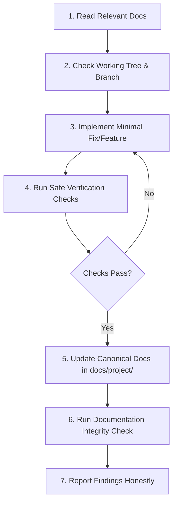

# AGENTS.md — Developer Agent Operating Directives

> **MANDATORY INSTRUCTION FOR ALL AI CODING AGENTS AND DEVELOPERS**
> This repository (`Connect2Code` / `c2c`) is a production placement preparation and coding assessment platform.
> Any agent modifying, extending, or debugging this codebase MUST strictly follow the directives in this document.
> Failure to adhere to these rules risks breaking production authentication, CORS compliance, or code execution.

---

## 1. Prime Directives

1. **Read Before Writing**: Before modifying any source code, read the relevant canonical documentation in [`docs/project/`](docs/project/).
2. **Verify Against Code**: Documentation reflects observed states and empirical tests. When documentation and active implementation conflict, inspect the source code as ground truth, reconcile the discrepancy, and update the documentation.
3. **Preserve Working-Tree Changes**: NEVER run destructive git commands (`git reset --hard`, `git checkout -- .`, `git clean -fd`, `git stash drop`). Always check `git status` first and preserve any pre-existing user changes.
4. **Make the Smallest Correct Change**: Do not rewrite working modules or introduce gratuitous abstractions. Target the precise root cause.
5. **No Blind Assumptions**: Never invent backend endpoints, query parameters, or token names. Check [`src/core/api/endpoints.ts`](src/core/api/endpoints.ts) and [`docs/project/05_api_contracts_and_security.md`](docs/project/05_api_contracts_and_security.md).
6. **Honest Verification Reporting**: Use standardized verification statuses (`VERIFIED`, `RUNTIME-VERIFIED`, `PARTIALLY VERIFIED`, `INFERRED`, `UNKNOWN`, `NOT WORKING`). Never claim a feature or fix works unless the check actually passed.

---

## 2. Repository Documentation Architecture

The authoritative project documentation lives in [`docs/project/`](docs/project/):

| Document | Scope & Contents |
| :--- | :--- |
| [**01_project_overview.md**](docs/project/01_project_overview.md) | Mission, verified platform features, technology stack, backend boundary, and scope. |
| [**02_architecture_and_conventions.md**](docs/project/02_architecture_and_conventions.md) | Architecture layers, directory layout, entry points, prohibited patterns, and coding conventions. |
| [**03_routing_roles_and_journeys.md**](docs/project/03_routing_roles_and_journeys.md) | Full route map, route guards (`ProtectedRoute`, `GuestRoute`, `AdminRoute`), and user journeys. |
| [**04_ui_design_and_components.md**](docs/project/04_ui_design_and_components.md) | Design tokens, Tailwind v4, dark/light themes, brand logo policy, and UI component catalog. |
| [**05_api_contracts_and_security.md**](docs/project/05_api_contracts_and_security.md) | REST endpoints, JWT authentication, `jwtToken` payload contract, refresh lock, and security rules. |
| [**06_state_management_and_data_flow.md**](docs/project/06_state_management_and_data_flow.md) | Redux Toolkit slices (8 total), caching strategies, async thunks, and user-scoped storage. |
| [**07_testing_and_verification_guide.md**](docs/project/07_testing_and_verification_guide.md) | Test runner (`node:test`), verification commands, mocking strategies, and regression coverage. |
| [**08_dev_environment_and_operations.md**](docs/project/08_dev_environment_and_operations.md) | Local setup, proxying, `.env` conventions, Vercel SPA rewrites, and GitHub Actions CI. |
| [**09_known_issues_and_decisions.md**](docs/project/09_known_issues_and_decisions.md) | Known backend defects, architectural trade-offs, and unresolved investigation areas. |
| [**10_file_coverage_and_verification_status.md**](docs/project/10_file_coverage_and_verification_status.md) | Exhaustive file-level coverage matrix across all 136 source files and scripts. |

---

## 3. Mandatory Workflow for Future Changes

Every agent task that creates, fixes, or modifies code MUST execute this sequence:

### Step-by-Step Instructions

1. **Investigate Context & Callers**:
   - Trace dependent components, Redux slices, services, and tests before touching a file.
   - Check if an API contract change affects both normal and admin services.
2. **Implement Minimal Changes**:
   - Never import `axios` directly outside [`src/core/api/apiClient.ts`](src/core/api/apiClient.ts).
   - Never make direct `fetch()` calls in feature components.
   - Never use `Math.random()` for application data or IDs.
   - Always route authenticated payloads through `apiClient` which enforces `jwtToken` and purges obsolete `token` fields.
3. **Execute Verification Checks**:
   - `npm test`: Runs Node.js test runner across all test suites in `scripts/tests/`.
   - `npm run typecheck`: Runs `tsc -p tsconfig.json --noEmit`. Must exit with 0 errors.
   - `npm run lint`: Runs `oxlint`. Must exit with 0 errors and 0 warnings.
   - `npm run build`: Validates Vite production bundling.
   - `node scripts/verify-documentation.mjs`: Verifies internal links, paths, and documentation integrity.
4. **Update Documentation in the Same Task**:
   - If an endpoint, route, component, or store slice is altered, immediately update the corresponding file in `docs/project/`.
   - Update [`10_file_coverage_and_verification_status.md`](docs/project/10_file_coverage_and_verification_status.md) whenever a file's status changes.
   - If a new bug or workaround is discovered, document it in [`09_known_issues_and_decisions.md`](docs/project/09_known_issues_and_decisions.md).
5. **Report Honestly**:
   - Clearly state which checks passed and which were unexecuted or failed.
   - Never claim complete line-by-line inspection if any file was skipped.

---

## 4. Architectural Rules That Must Never Be Broken

- **API Domain**: The production API domain is strictly `https://api.connect2code.in/api/v1`. Never use `.com` or the legacy Render domain.
- **Token Field Contract**: The Spring Boot backend expects the access token inside request bodies as `jwtToken`. Duplicate fields named `token`, `jwttoken`, or `jwt_token` must be stripped by `purgeDuplicateTokenFields` in `apiClient.ts`.
- **MCQ Option Correctness**: In MCQ authoring and practice, correctness is determined strictly by the `isCorrect: true/false` property on individual options in `options[]`. Never rely solely on top-level `correctOption` or `correctAnswer` strings, which may be stale.
- **Logo Policy**: All company and brand logos are bundled locally in `public/companies/` and registered in [`src/features/companies/utils/companyLogoRegistry.ts`](src/features/companies/utils/companyLogoRegistry.ts). Never replace them with generic external placeholders.
- **Multi-Tenant User Storage**: All user progress, bookmarks, and local state stored in browser storage must use [`src/core/storage/userScopedStorage.ts`](src/core/storage/userScopedStorage.ts) to prevent cross-user data bleed.

---

## 5. Verification Commands Quick Reference

| Command | Purpose | Expected Result |
| :--- | :--- | :--- |
| `npm test` | Node test runner across `scripts/tests/*.test.mjs` | All suites pass (0 fails) |
| `npm run typecheck` | TypeScript compiler check without emitting | Clean output, exit code 0 |
| `npm run lint` | Oxlint linter across `src/` | 0 errors, 0 warnings |
| `npm run build` | Production Vite build | Clean bundle in `dist/` |
| `node scripts/verify-documentation.mjs` | Documentation integrity and link checker | All links and file references valid |
| `npm run verify:architecture` | Architecture rule scanner | Passes when `.env` is absent |
