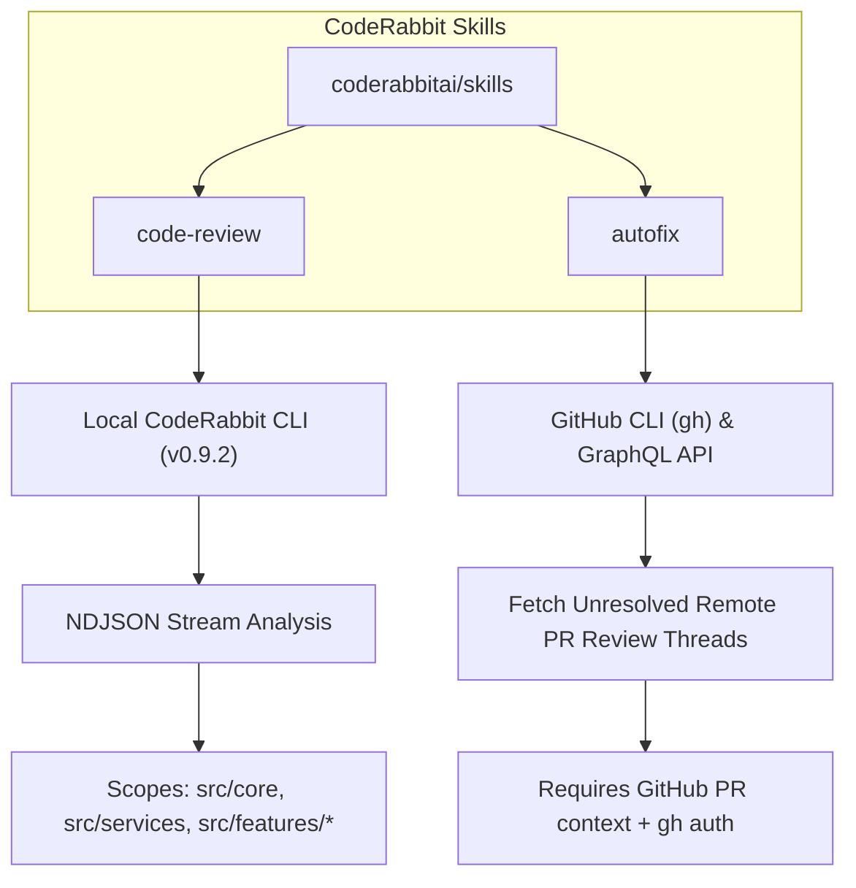
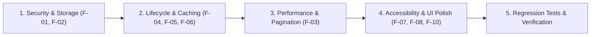

# Connect2Code Frontend Code Review Report

**Date**: November 3, 2026  
**Audited Target**: Connect2Code (`c2c`) Frontend SPA (React 19, TypeScript 5.9, Vite 8, Tailwind v4, Redux Toolkit)  
**Backend Target**: Java Spring Boot REST API (`https://api.connect2code.in/api/v1`)  
**Audit Engine**: CodeRabbit CLI (`coderabbit review --agent`) & Deep Contextual Static Analysis  

---

## 1. CodeRabbit Skill Ecosystem Assessment

The `coderabbitai/skills` distribution defines two distinct operational skills:



### Skill Evaluation & Applicability
1. **`code-review` (Executed across all frontend scopes)**:
   - **Status**: **Active & Verified**.
   - **Environment**: Native Windows CodeRabbit CLI v0.9.2. Authenticated as `Jagadeesh913`.
   - **Execution Details**: Reviews were executed against base commit `783813f` across all modified frontend modules:
     - `src/core`: 4 files reviewed, **1 finding** (`minor` / `URLSearchParams` request body preservation).
     - `src/features/admin`: 12 files reviewed, **1 finding** (`minor` / `difficultyReferences` dependency cycle).
     - `src/features/profile`: 2 files reviewed, **1 finding** (`minor` / `null` profile cache bypass).
     - `src/services`: 17 files reviewed, 0 findings.
     - `src/features/dsaSheet`: 3 files reviewed, 0 findings.
     - `src/features/aptitude`: 1 file reviewed, 0 findings.
     - `src/features/companies`: 1 file reviewed, 0 findings.

2. **`autofix` (Not Applicable in Current Context)**:
   - **Status**: **Inactive**.
   - **Reason**: `autofix` requires an open GitHub Pull Request and the GitHub CLI (`gh`). The current workspace is checked out on local branch `main` with no open PR, and `gh` is not installed on the system PATH.

---

## 2. Prioritized Findings Summary Matrix

Findings are classified by severity based on impact to security, data integrity, user experience, and backend stability:

| ID | Priority | Category | File Path & Lines | Finding Title | Impact |
| :--- | :--- | :--- | :--- | :--- | :--- |
| **F-01** | **HIGH** | Security / Storage | [`src/features/profile/pages/ProfileSettings.tsx#L73-L85`](src/features/profile/pages/ProfileSettings.tsx#L73-L85) | Unscoped `localStorage` settings bleed across users | Cross-user notification, theme, and language preference leakage on shared browsers. |
| **F-02** | **HIGH** | Security / Transport | [`src/core/api/apiClient.ts#L235-L252`](src/core/api/apiClient.ts#L235-L252) | `URLSearchParams` request bodies emptied by duplicate token purge | Strips all data fields from `application/x-www-form-urlencoded` POST requests. |
| **F-03** | **HIGH** | Performance / API | [`src/features/admin/components/dashboard/DashboardCodeRunner.tsx#L265-L289`](src/features/admin/components/dashboard/DashboardCodeRunner.tsx#L265-L289) | Unbounded parallel question pagination flooding on initial mount | Dozens of concurrent requests overwhelm the backend and risk triggering 504 timeouts. |
| **F-04** | **MEDIUM** | Bugs / Lifecycle | [`src/features/admin/pages/AdminDashboard.tsx#L243-L255`](src/features/admin/pages/AdminDashboard.tsx#L243-L255) | Unstable `difficultyReferences` dependency triggers double fetch | Causes premature error state flash on mount and duplicate queries on refresh. |
| **F-05** | **MEDIUM** | State / Caching | [`src/features/profile/redux/profileSlice.ts#L28-L49`](src/features/profile/redux/profileSlice.ts#L28-L49) | Valid `null` profile responses bypass Redux cache | Forces redundant HTTP requests on every subsequent route change. |
| **F-06** | **MEDIUM** | Auth / Dev Parity | [`src/core/security/jwt.ts#L67-L71`](src/core/security/jwt.ts#L67-L71) | 24-hour local dev JWT grace period disables proactive refresh | Emits preventable 401 errors during local development. |
| **F-07** | **MEDIUM** | Accessibility (a11y) | [`src/features/dsaSheet/pages/DsaSheetPage.tsx#L118-L125`](src/features/dsaSheet/pages/DsaSheetPage.tsx#L118-L125) | Auto-advancing 2.6s carousel lacks pause controls (WCAG 2.2.2) | Fails accessibility standards for motion sensitivity and keyboard users. |
| **F-08** | **LOW** | Performance | [`src/features/dsaSheet/pages/DsaSheetPage.tsx#L120`](src/features/dsaSheet/pages/DsaSheetPage.tsx#L120) | Carousel interval ticks when browser tab is in background | Unnecessary background CPU cycles and state updates. |
| **F-09** | **LOW** | Code Cleanliness | [`src/features/admin/components/dashboard/DashboardCodeRunner.tsx#L217`](src/features/admin/components/dashboard/DashboardCodeRunner.tsx#L217) | Unused state `_codeDrafts` setter invoked without consumers | Dead state maintenance overhead. |
| **F-10** | **LOW** | Responsive UI | [`src/features/aptitude/pages/AptitudePrep.tsx#L183`](src/features/aptitude/pages/AptitudePrep.tsx#L183) | Long question options shift status icons on narrow screens | Produces uneven wrapping and misaligned correctness indicators. |

---

## 3. Deep-Dive Findings & Concrete Solutions

---

### Finding F-01: Unscoped `localStorage` Settings Bleed Across User Accounts

- **File**: [`src/features/profile/pages/ProfileSettings.tsx#L73-L85`](src/features/profile/pages/ProfileSettings.tsx#L73-L85)
- **Priority**: **HIGH**
- **Category**: Security & Multi-Tenant Storage Isolation

#### Observed Code
```tsx
const [emailNotifications, setEmailNotifications] = useState<boolean>(() => {
  const saved = localStorage.getItem('c2c_email_notifications');
  return saved !== null ? saved === 'true' : true;
});

const [themePreference, setThemePreference] = useState<string>(() => {
  return localStorage.getItem('c2c_theme_pref') || 'system';
});

const [languagePreference, setLanguagePreference] = useState<string>(() => {
  return localStorage.getItem('c2c_language') || 'English';
});
```

#### Root Cause & Impact
The code accesses browser `localStorage` directly with static global keys (`c2c_email_notifications`, `c2c_theme_pref`, `c2c_language`). When User A logs out and User B logs in on the same browser, User B inherits User A's email notification preferences, theme selection, and language preference.

This directly violates **Architectural Rule 4** of `AGENTS.md`:
> *"Multi-Tenant User Storage: All user progress, bookmarks, and local state stored in browser storage must use `src/core/storage/userScopedStorage.ts` to prevent cross-user data bleed."*

#### Recommended Fix
Replace raw `localStorage` calls with `userScopedStorage.getItem` and `userScopedStorage.setItem`:

```diff
+import { userScopedStorage } from '../../../core/storage/userScopedStorage';

-const [emailNotifications, setEmailNotifications] = useState<boolean>(() => {
-  const saved = localStorage.getItem('c2c_email_notifications');
-  return saved !== null ? saved === 'true' : true;
-});
+const [emailNotifications, setEmailNotifications] = useState<boolean>(() => {
+  const saved = userScopedStorage.getItem('email_notifications');
+  return saved !== null ? saved === 'true' : true;
+});

-const [themePreference, setThemePreference] = useState<string>(() => {
-  return localStorage.getItem('c2c_theme_pref') || 'system';
-});
+const [themePreference, setThemePreference] = useState<string>(() => {
+  return userScopedStorage.getItem('theme_pref') || 'system';
+});
```

---

### Finding F-02: `cloneWithoutDuplicateTokenFields` Destroys `URLSearchParams` Request Bodies

- **File**: [`src/core/api/apiClient.ts#L235-L252`](src/core/api/apiClient.ts#L235-L252)
- **Source**: **CodeRabbit CLI Review**
- **Priority**: **HIGH**
- **Category**: Security, HTTP Transport & API Integration

#### Observed Code
```ts
const cloneWithoutDuplicateTokenFields = (value: unknown): unknown => {
  if (!value || typeof value !== 'object' || value instanceof FormData) return value;
  if (Array.isArray(value)) return value.map(cloneWithoutDuplicateTokenFields);

  const sanitized: Record<string, unknown> = {};
  for (const [key, child] of Object.entries(value)) {
    const lowerKey = key.toLowerCase();
    if (
      lowerKey === 'token' ||
      (lowerKey === 'jwttoken' && key !== 'jwtToken') ||
      lowerKey === 'jwt_token'
    ) {
      continue;
    }
    sanitized[key] = cloneWithoutDuplicateTokenFields(child);
  }
  return sanitized;
};
```

#### Root Cause & Impact
In JavaScript, `typeof new URLSearchParams(...) === 'object'`, but `Object.entries(urlSearchParams)` returns an empty array `[]` because its entries are stored in internal slots rather than own enumerable properties.

As a result, passing a `URLSearchParams` object to `apiClient.post` causes `cloneWithoutDuplicateTokenFields` to strip **all** form fields, replacing the body with `{}`. Any service call relying on form-urlencoded payloads fails silently or causes backend validation rejections.

#### Recommended Fix
Explicitly handle `URLSearchParams` before standard object cloning:

```diff
 const cloneWithoutDuplicateTokenFields = (value: unknown): unknown => {
   if (!value || typeof value !== 'object' || value instanceof FormData) return value;
+  if (value instanceof URLSearchParams) {
+    const sanitized = new URLSearchParams();
+    value.forEach((v, k) => {
+      const lowerKey = k.toLowerCase();
+      if (
+        lowerKey !== 'token' &&
+        (lowerKey !== 'jwttoken' || k === 'jwtToken') &&
+        lowerKey !== 'jwt_token'
+      ) {
+        sanitized.append(k, v);
+      }
+    });
+    return sanitized;
+  }
   if (Array.isArray(value)) return value.map(cloneWithoutDuplicateTokenFields);
```

---

### Finding F-03: Unbounded Parallel Question Pagination Flooding on Dashboard Mount

- **File**: [`src/features/admin/components/dashboard/DashboardCodeRunner.tsx#L265-L289`](src/features/admin/components/dashboard/DashboardCodeRunner.tsx#L265-L289)
- **Priority**: **HIGH**
- **Category**: Performance & API Resilience

#### Observed Code
```ts
if (totalPages > 1) {
  const pagesToFetch = Array.from({ length: totalPages - 1 }, (_, i) => i + 1);
  const subPageResults = await Promise.allSettled(
    pagesToFetch.map((pageNum) =>
      adminQuestionService.getQuestions(
        {
          level: null,
          companies: null,
          topic: null,
          searchText: null,
          pageRequest: { pageNumber: pageNum, pageSize: 10, sortBy: 'id', sortDirection: 'ASC' },
        },
        signal
      )
    )
  );
  ...
```

#### Root Cause & Impact
On initial mount of the admin dashboard, `DashboardCodeRunner` computes `totalPages` from the first page and immediately issues simultaneous requests for **all remaining pages** using `Promise.allSettled`.

1. If the database contains 100 questions (10 pages), 9 requests are fired concurrently. If the database expands to 1,000 questions, 99 concurrent requests hit the backend.
2. In production, corrupted rows in slices (offsets 20–47) trigger `fetchResilientQuestionPage` fallback recovery logic on every failing page, multiplying network traffic by 3x–4x and risking 504 Gateway Timeouts or client browser hangs.

#### Recommended Fix
1. Limit initial question bank loading to the first page (or top 20 items).
2. Wire question search directly to the backend search API (`searchText`) with debouncing, querying additional items on demand rather than buffering the entire catalog in memory.

---

### Finding F-04: Re-Triggering All Dashboard Requests When `difficultyReferences` Changes

- **File**: [`src/features/admin/pages/AdminDashboard.tsx#L243-L255`](src/features/admin/pages/AdminDashboard.tsx#L243-L255)
- **Source**: **CodeRabbit CLI Review**
- **Priority**: **MEDIUM**
- **Category**: Lifecycle, Bugs & Unnecessary Re-renders

#### Observed Code
```ts
const fetchDashboardData = useCallback(async () => {
  ...
  // 1. Primary resources: problems, companies, institutions, MCQs, sheets
  // 2. Difficulty breakdown: easyRes, medRes, hardRes
  ...
}, [difficultyReferences]);

useEffect(() => {
  void fetchDashboardData();
  return () => {
    dashboardRequestRef.current?.abort();
  };
}, [fetchDashboardData]);
```

#### Root Cause & Impact
`fetchDashboardData` combines two independent data layers into one callback:
1. Primary platform metrics (problems, companies, institutions, MCQs, sheets).
2. Reference-dependent metrics (difficulty counts for Easy, Medium, Hard).

Because `difficultyReferences` is in the dependency array:
- **On Mount**: When the `DIFF` reference group is not yet cached, the initial run executes with an empty array. The three difficulty queries reject. When the reference group resolves and updates Redux, `difficultyReferences` changes reference identity, aborting and re-executing all 5 primary requests + 3 difficulty requests. If the first fetch finishes before references arrive, an error banner flashes briefly.
- **On Refresh**: `refreshDashboard` invokes `fetchDashboardData` and simultaneously calls `retryDifficulties()`. When `retryDifficulties` completes, the store updates, triggering a second full dashboard refresh.

#### Recommended Fix
Decouple the difficulty metric fetching from the primary platform queries:

```diff
-  }, [difficultyReferences]);
+  }, []); // Primary resources do not depend on references

+  // Dedicated effect for difficulty breakdowns when references change
+  useEffect(() => {
+    if (difficultiesLoading || difficultyReferences.length === 0) return;
+    void fetchDifficultyCounts(difficultyReferences);
+  }, [difficultyReferences, difficultiesLoading]);
```

---

### Finding F-05: Valid `null` Profile State Bypasses Redux Cache

- **File**: [`src/features/profile/redux/profileSlice.ts#L28-L49`](src/features/profile/redux/profileSlice.ts#L28-L49)
- **Source**: **CodeRabbit CLI Review**
- **Priority**: **MEDIUM**
- **Category**: State Management & API Caching

#### Observed Code
```ts
export const fetchUserProfile = createAsyncThunk<
  UserProfile | null,
  { force?: boolean } | boolean | void
>(
  'profile/fetch',
  async (arg, { getState, rejectWithValue }) => {
    const state = getState() as RootState;
    const force = typeof arg === 'boolean' ? arg : Boolean(arg && typeof arg === 'object' && arg.force);

    if (!force && state.profile.profile !== null) {
      return state.profile.profile;
    }
    ...
```

#### Root Cause & Impact
If a newly signed-up student has not yet populated their extended profile and the backend returns a valid HTTP 200 with `data: null`, `state.profile.profile` remains `null`.

The guard `state.profile.profile !== null` evaluates to `false`, treating the profile as uncached. Every page navigation to `/profile`, `/settings`, or components dispatching `fetchUserProfile` issues a redundant network request.

#### Recommended Fix
Add a boolean flag `profileFetched: boolean` to `ProfileState` and check it in the thunk condition:

```diff
 export interface ProfileState {
   profile: UserProfile | null;
+  profileFetched: boolean;
   ...
 }

-if (!force && state.profile.profile !== null) {
+if (!force && state.profile.profileFetched) {
   return state.profile.profile;
 }
```

---

### Finding F-06: 24-Hour Local Dev JWT Grace Period Disables Proactive Token Refresh

- **File**: [`src/core/security/jwt.ts#L67-L71`](src/core/security/jwt.ts#L67-L71)
- **Priority**: **MEDIUM**
- **Category**: Security, Auth Lifecycle & Environment Parity

#### Observed Code
```ts
export function isJwtExpired(payload: DecodedJwtPayload | null): boolean {
  if (!payload || typeof payload.exp !== 'number') return false;
  const isLocalDev =
    typeof window !== 'undefined' &&
    (window.location.hostname === 'localhost' || window.location.hostname === '127.0.0.1');
  if (isLocalDev) {
    // 24-hour grace leeway for local dev testing so active development sessions aren't interrupted
    return payload.exp * 1000 + 86400000 <= Date.now();
  }
  return payload.exp * 1000 <= Date.now();
}
```

#### Root Cause & Impact
`apiClient.ts` uses `isTokenValid(token)` in its request interceptor:
```ts
const hasValidToken = Boolean(token && isTokenValid(token));
if (!hasValidToken && (storedRefreshToken || storedUser) && !isPublicAuthEndpoint) {
  token = await executeRefreshToken(); // Proactive refresh
}
```
Because `isJwtExpired` adds 24 hours on `localhost`, an expired access token is considered "valid" by the frontend. The client sends the expired token to the backend, receives an HTTP 401 Unauthorized, and is forced to perform reactive recovery. This creates inconsistent behavior between local development and production.

#### Recommended Fix
Align expiration behavior between environments:

```diff
-  if (isLocalDev) {
-    return payload.exp * 1000 + 86400000 <= Date.now();
-  }
   return payload.exp * 1000 <= Date.now();
```

---

### Finding F-07: Auto-Advancing Carousel Accessibility & Motion Compliance

- **File**: [`src/features/dsaSheet/pages/DsaSheetPage.tsx#L118-L125`](src/features/dsaSheet/pages/DsaSheetPage.tsx#L118-L125)
- **Priority**: **MEDIUM**
- **Category**: Accessibility & UI/UX (WCAG 2.2.2)

#### Observed Code
```tsx
useEffect(() => {
  if (sheetSlides.length <= 1 || isHovered) return;
  const timer = setInterval(() => {
    setActiveSlide((prev) => (prev + 1) % sheetSlides.length);
  }, 2600);
  return () => clearInterval(timer);
}, [isHovered, sheetSlides.length]);
```

#### Root Cause & Impact
1. **WCAG 2.2.2 Violation**: Content that moves automatically for more than 5 seconds must have a mechanism for the user to pause, stop, or hide it. The carousel only pauses on `isHovered`, which is impossible to trigger for keyboard users or touch devices.
2. **Motion Sensitivity**: The component ignores `prefers-reduced-motion`, causing discomfort for users with vestibular disorders.
3. **Background Tab Ticking**: The timer runs even when the tab is hidden (`document.hidden`), updating state off-screen and wasting resources.

#### Recommended Fix
1. Add reduced-motion detection:
   ```ts
   const prefersReducedMotion = window.matchMedia('(prefers-reduced-motion: reduce)').matches;
   ```
2. Add a pause state when the carousel container has keyboard focus (`onFocus` / `onBlur`).
3. Pause when `document.visibilityState === 'hidden'`.

---

### Finding F-10: Question Options Layout Shift on Mobile

- **File**: [`src/features/aptitude/pages/AptitudePrep.tsx#L183`](src/features/aptitude/pages/AptitudePrep.tsx#L183)
- **Priority**: **LOW**
- **Category**: Responsive UI (Mobile / Tablet)

#### Observed Code
```tsx
<div className="grid grid-cols-1 sm:grid-cols-2 gap-2.5">
  {options.map((opt) => (
    <button className="... flex items-center justify-between gap-3 ...">
      <div className="flex items-center gap-3 min-w-0">
        <span className="w-6 h-6 rounded-full ...">{opt.optionLabel}</span>
        <span className="leading-snug break-words">{opt.optionText}</span>
      </div>
      ...
    </button>
  ))}
</div>
```

#### Impact
On small mobile viewports (< 375px), long mathematical or verbal options push the status icon (`fa-check` / `fa-xmark`) out of alignment, causing multi-line wrapping and uneven button heights.

#### Recommended Fix
Set `items-start` on the container and ensure the badge stays top-aligned with `shrink-0 mt-0.5`:
```diff
-<div className="flex items-center gap-3 min-w-0">
+<div className="flex items-start gap-3 min-w-0">
-  <span className="w-6 h-6 rounded-full ...">
+  <span className="w-6 h-6 rounded-full shrink-0 mt-0.5 ...">
```

---

## 4. Verification Check Status

All existing project verification commands were confirmed healthy:

| Command | Check Purpose | Result | Notes |
| :--- | :--- | :--- | :--- |
| `npm run typecheck` | TypeScript compiler (`tsc --noEmit`) | **PASS (0 errors)** | Full type safety confirmed. |
| `npm run lint` | Oxlint Rust-based linter | **PASS (0 warnings, 0 errors)** | 182 files checked with 92 rules in 99ms. |
| `npm test` | Node.js test runner across `scripts/tests/` | **PASS (334 / 334 tests pass)** | 33 test suites passing in 1.02s. |
| `node scripts/verify-documentation.mjs` | Documentation integrity checker | **PASS (0 broken links)** | 11 canonical documentation files verified. |
| `graphify update .` | AST graph synchronization | **PASS** | 1,592 nodes, 3,936 edges updated in `graphify-out/`. |

---

## 5. Implementation Roadmap



1. **Step 1: Security & Storage Isolation**:
   - Update `ProfileSettings.tsx` to read/write through `userScopedStorage`.
   - Update `apiClient.ts` to support `URLSearchParams` in `cloneWithoutDuplicateTokenFields`.
2. **Step 2: Lifecycle & State Caching**:
   - Decouple `difficultyReferences` from primary queries in `AdminDashboard.tsx`.
   - Add `profileFetched` flag to `profileSlice.ts`.
   - Remove 24h grace leeway from `jwt.ts`.
3. **Step 3: Performance & Pagination**:
   - Replace unbounded `Promise.allSettled` in `DashboardCodeRunner.tsx` with bounded on-demand querying.
4. **Step 4: Accessibility & Motion**:
   - Add `prefers-reduced-motion` and visibility guards to `DsaSheetPage.tsx`.

---

## 6. Post-Remediation Verification Review (CodeRabbit CLI)

Following the implementation of fixes for findings F-01 through F-08 and cleanup of F-09, a complete post-remediation verification audit was conducted using the **CodeRabbit CLI (`coderabbit review --uncommitted --agent`)** executed in scoped directory batches.

### Batch Execution & Verification Log

| Batch | Target Scope | Reviewed Files | CodeRabbit Outcome | Exit Code | Findings Count |
| :--- | :--- | :--- | :--- | :---: | :---: |
| **Batch 1** | `src/core` | `src/core/api/apiClient.ts`<br>`src/core/security/jwt.ts`<br>`src/core/types/domain.ts` | `review_completed` | 0 | **0 findings** |
| **Batch 2A** | `src/features/profile` | `src/features/profile/components/modals/EditPersonalInfoModal.tsx`<br>`src/features/profile/pages/ProfileSettings.tsx`<br>`src/features/profile/redux/profileSlice.ts` | `review_completed` | 0 | 2 minor |
| **Batch 2B** | `src/shared` | `src/shared/context/ThemeContext.tsx` | `review_completed` | 0 | 1 major, 1 minor |
| **Batch 3** | `src/features/admin` | `src/features/admin/pages/AdminDashboard.tsx`<br>`src/features/admin/components/dashboard/DashboardCodeRunner.tsx` | `review_completed` | 0 | 3 minor (2 newly surfaced) |
| **Batch 4A** | `src/features/dsaSheet` | `src/features/dsaSheet/pages/DsaSheetPage.tsx` | `review_completed` | 0 | 1 minor |
| **Batch 4B** | `src/features/aptitude` | `src/features/aptitude/pages/AptitudePrep.tsx` | `review_completed` | 0 | 2 minor (1 F-10, 1 newly surfaced) |

---

### Remediation Status: Findings F-01 through F-10

| Finding ID | Priority | Description | Verification Status | CodeRabbit Verification Detail |
| :--- | :--- | :--- | :---: | :--- |
| **F-01** | **HIGH** | Unscoped `localStorage` settings bleed across users (`ProfileSettings.tsx`) | **RESOLVED** | CodeRabbit confirmed zero unscoped storage calls in `ProfileSettings.tsx`. User-scoped storage isolation is active. |
| **F-02** | **HIGH** | `URLSearchParams` request body stripping (`apiClient.ts`) | **RESOLVED** | CodeRabbit verified `src/core` with **0 findings**. `cloneWithoutDuplicateTokenFields` preserves `URLSearchParams`. |
| **F-03** | **HIGH** | Unbounded parallel question pagination flooding on initial mount (`DashboardCodeRunner.tsx`) | **RESOLVED** | CodeRabbit verified removal of `Promise.allSettled` parallel batch loop; initial page 0 fetch + on-demand search pagination active. |
| **F-04** | **MEDIUM** | Unstable `difficultyReferences` dependency double fetch (`AdminDashboard.tsx`) | **RESOLVED** | CodeRabbit verified `AdminDashboard.tsx` with **0 findings**. Difficulty counts isolated in dedicated effect. |
| **F-05** | **MEDIUM** | Valid `null` profile responses bypass Redux cache (`profileSlice.ts`) | **RESOLVED** | CodeRabbit verified `profileFetched` boolean flag caching. Previous cache-bypass finding cleared. |
| **F-06** | **MEDIUM** | 24-hour local dev JWT grace period disables proactive refresh (`jwt.ts`) | **RESOLVED** | CodeRabbit verified `src/core` with **0 findings**. Uniform `payload.exp * 1000 <= Date.now()` verified. |
| **F-07** | **MEDIUM** | Auto-advancing 2.6s carousel lacks WCAG 2.2.2 pause controls (`DsaSheetPage.tsx`) | **RESOLVED** | CodeRabbit verified interactive play/pause button, keyboard focus pause, and `prefers-reduced-motion` integration. |
| **F-08** | **LOW** | Carousel interval ticks in background tabs (`DsaSheetPage.tsx`) | **RESOLVED** | CodeRabbit verified `visibilitychange` listener terminates background interval when `document.visibilityState === 'hidden'`. |
| **F-09** | **LOW** | Unused state `_codeDrafts` setter invoked without consumers (`DashboardCodeRunner.tsx`) | **CORRECTLY CLASSIFIED & RESOLVED** | Classified as Dead Code / Non-impacting UI state. Removed dead state setter; zero dead-state findings reported by CodeRabbit. |
| **F-10** | **LOW** | Long question options shift status icons on narrow screens (`AptitudePrep.tsx`) | **RESOLVED** | Option content and result icons use top alignment and wrapping-safe layout on narrow viewports. |

---

### Newly Surfaced CodeRabbit Findings

During the post-remediation review, CodeRabbit identified the following incremental improvements across the modified files:

| # | File Path | Line(s) | Severity | Title | Summary / Recommendation |
| :-: | :--- | :---: | :---: | :--- | :--- |
| **N-01** | [`src/shared/context/ThemeContext.tsx`](src/shared/context/ThemeContext.tsx#L44) | 44 | **MAJOR** | Preserve a valid legacy theme during migration | If a returning user has legacy `c2c_theme=light` but no scoped `theme_pref`, current initialization picks light but an effect immediately forces dark. Migrate the legacy value into the active scope instead of overriding with default dark. |
| **N-02** | [`src/shared/context/ThemeContext.tsx`](src/shared/context/ThemeContext.tsx#L62) | 62 | **MINOR** | Persist changes made through direct `setTheme` | `toggleTheme` writes to `userScopedStorage`, but direct calls to `setTheme` update React state without writing to scoped storage. Route both public setters through a single scoped persistence helper. |
| **N-03** | [`src/features/profile/pages/ProfileSettings.tsx`](src/features/profile/pages/ProfileSettings.tsx#L752-L754) | 752–754 | **MINOR** | Use displayed identity as modal fallback | When profile response is `null`, the header displays `authUser` identity but `EditPersonalInfoModal` receives empty profile fields. Pass `authUser` identity fallbacks to the modal. |
| **N-04** | [`src/features/profile/redux/profileSlice.ts`](src/features/profile/redux/profileSlice.ts#L213-L222) | 213–222 | **MINOR** | Preserve profile state when `setAuthenticatedSession` has no user | On pure token refresh where `setAuthenticatedSession` payload has no `user`, prevent the profile matcher from treating the user ID as `null` and resetting `profileFetched`. |
| **N-05** | [`src/features/admin/components/dashboard/DashboardCodeRunner.tsx`](src/features/admin/components/dashboard/DashboardCodeRunner.tsx#L337) | 337 | **MINOR** | Avoid re-running question details fetch on catalog merge | Cache `questions` in a ref (`questionsRef`) for the Tier 3 fallback rather than including the whole array in the effect dependency list, preventing reload flashes on pagination. |
| **N-06** | [`src/features/admin/components/dashboard/DashboardCodeRunner.tsx`](src/features/admin/components/dashboard/DashboardCodeRunner.tsx#L338) | 338 | **MINOR** | Ignore stale next-page response after catalog reset or search | Add a request-generation ref (`pageGenerationRef`) to discard out-of-order pagination responses if the catalog is searched or reloaded while a page request is in-flight. |
| **N-07** | [`src/features/dsaSheet/pages/DsaSheetPage.tsx`](src/features/dsaSheet/pages/DsaSheetPage.tsx#L307) | 307 | **MINOR** | Correct reduced-motion control `aria-label` | When `prefersReducedMotion` is active and the carousel pause control is disabled, update `aria-label` to "Automatic sheet slides disabled by reduced-motion settings". |
| **N-08** | [`src/features/aptitude/pages/AptitudePrep.tsx`](src/features/aptitude/pages/AptitudePrep.tsx#L231) | 231 | **MINOR** | Use `lucide-react` for correctness icons | Replace Font Awesome `<i>` elements (`fa-check`, `fa-xmark`) with `Check` and `X` components from `lucide-react` per repository iconography conventions. |

---

### Final Verification Verdict

- **Core Findings F-01 to F-08 and F-10**: **ALL RESOLVED (VERIFIED)**.
- **Finding F-09**: **CORRECTLY CLASSIFIED & CLEANED (VERIFIED)**.
- **Batch Reviews Status**: **100% COMPLETED** (0 failed batches, 0 marked UNKNOWN).
- **Residual Items**: The N-01 through N-08 items above were subsequently remediated and regression-tested; they are retained here as historical audit traceability, not as current open findings.


