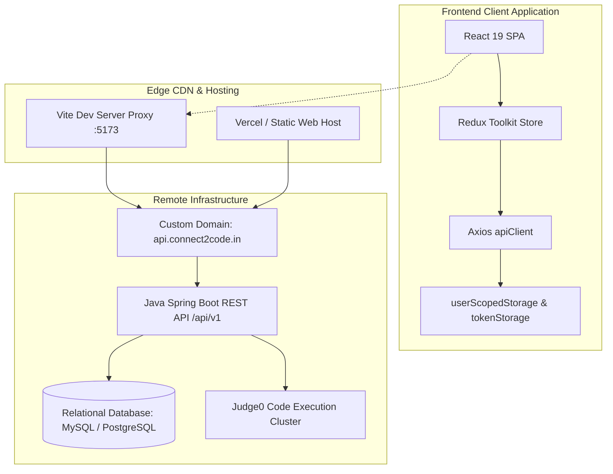

# 01. Project Overview & Scope

## 1. Mission and Platform Purpose

**Connect to Code (C2C)** is an end-to-end placement preparation, assessment, and coding platform engineered for college students, job seekers, and educational institutions in India and globally.

The application combines:
1. **Interactive Coding Practice**: Monaco-editor powered environment supporting multi-language code compilation and testing via a remote Judge0 engine.
2. **Company Recruitment Guides**: Exam syllabus, pattern breakdowns, and company-specific past questions for 30+ leading tech recruiters (TCS, Infosys, Wipro, Google, Amazon, Microsoft, etc.).
3. **Structured DSA Sheets**: Topic-wise curricula (Arrays, Strings, Trees, Graphs, Dynamic Programming) with difficulty categorization and real-time solved progress tracking.
4. **Aptitude & MCQ Assessment Engine**: Multi-subject question banks covering Quantitative Aptitude, Logical Reasoning, Verbal Ability, and Pseudocode, featuring test simulation, review mode, and instant score computation.
5. **Academic & User Profile Management**: User profile with degree, branch, passing year, AISHE college auto-complete, and performance metrics (solved counts, streak, accuracy).
6. **Administrative Hub**: Role-gated management portal (`/admin/*`) enabling administrators to manage problems, test cases, MCQs, company exams, recruitment rounds, supported compiler languages, and educational institution directories.

---

## 2. Technology Stack & Runtime Environment

| Category | Technology | Version | Purpose / Rationale |
| :--- | :--- | :--- | :--- |
| **Frontend Framework** | React | `^19.2.8` | High-performance SPA with modern React 19 Concurrent rendering. |
| **Build Tool & Dev Server**| Vite | `^8.2.0` | Ultra-fast HMR and optimized ES module bundling. |
| **Language** | TypeScript | `^5.9.3` | Strict static typing (`strict: true`, ES2022 target). |
| **Styling & Design System**| Tailwind CSS | `^4.3.3` | Zero-runtime CSS styling via `@tailwindcss/vite` plugin. |
| **State Management** | Redux Toolkit | `^2.12.0` | Centralized predictable state with Redux Toolkit and React-Redux `^9.3.0`. |
| **Routing** | React Router | `^7.18.2` | Data-router (`createBrowserRouter`) with lazy page code splitting and guards. |
| **HTTP Transport** | Axios | `^1.19.0` | Unified client instance (`src/core/api/apiClient.ts`) with refresh interceptors. |
| **Code Editor** | Monaco Editor | `^4.7.0` | VS Code-grade in-browser code editor via `@monaco-editor/react`. |
| **Schema Validation** | Zod | `^3.25.76` | Runtime form & payload validation paired with `@hookform/resolvers`. |
| **Forms** | React Hook Form| `^7.84.0` | Performant, uncontrolled form management with automatic error mapping. |
| **Form Resolver** | `@hookform/resolvers` | `^5.5.7` | Connects Zod schemas to React Hook Form on auth, profile, language, institution, company, and question forms. |
| **Animation** | Framer Motion | `^12.43.0` | Scoped to the shared admin modal and honors reduced-motion preference. |
| **Icons** | Lucide React | `^1.28.0` | Tree-shakeable icons for shared, admin, profile, and modernized feature UI. Legacy Font Awesome classes remain where replacing them would be a design rewrite. |
| **Notifications** | React Hot Toast | `^2.6.0` | One application-level toaster and mutation/error feedback. |
| **Linting** | Oxlint | `^1.75.0` | High-performance Rust-based linter executing 92 rules in < 50ms. |
| **Testing** | Node.js Test Runner| Built-in | Fast ESM-native tests (`node:test`, `node:assert/strict`) in `scripts/tests/`. |

---

## 3. System Boundary & Infrastructure Architecture

### Backend API Boundary
- **Production API Origin**: `https://api.connect2code.in`
- **API Base URL**: `https://api.connect2code.in/api/v1`
- **Protocol**: HTTPS REST JSON APIs with Cookie and JWT Bearer authorization.
- **Judge0 Engine**: Connected to the Spring Boot backend. The frontend never talks directly to Judge0; all compilation requests flow through `/api/v1/runCode` or `/api/v1/submitCode`.

---

## 4. Scope, Verified Features, and Known Limitations

### Fully Verified Core Capabilities
- **Authentication Lifecycle**: Email/password login, student signup, password reset with OTP, Google OAuth2 popup/callback, proactive token refresh, and single-flight concurrent refresh locking.
- **API Transport Hardening**: Strict enforcement of `jwtToken` in request bodies, recursive elimination of duplicate/stale `token` fields via `purgeDuplicateTokenFields`, query-parameter token leak prevention.
- **Problem Catalog & Filters**: Multi-faceted filtering by difficulty, topic, recruiter company, platform (LeetCode, GFG, HackerRank), search query, and pagination.
- **Monaco Code Runner**: Code execution uses the `/language` API's table-ID-to-reference-ID mapping, automatic Java class sanitization (`Main`), and sample test case execution. The client does not guess compiler IDs when the catalog is unavailable.
- **Company Exam Blueprints**: Recruitment exam schedules, role salaries, section durations, and question count visualizations.
- **Aptitude Bank**: Category-filtered practice (Quantitative, Reasoning, Verbal, Pseudocode), option synthesis respecting explicit `isCorrect: true/false`, and test submission scoring.
- **Admin Hub**: Full CRUD operations for problems, test cases, recruitment companies, exam blueprints, compiler languages, and educational institutions.
- **Multi-Tenant Client Storage**: Safe scoping of bookmarks, solved problem IDs, and user settings using FNV-1a hash identifiers in `userScopedStorage`.

### Known Limitations & Deferred Scopes
- **Full Submission Backend NPE**: On remote backend, `POST /api/v1/submitCode` and `POST /api/v1/admin/submitCode` occasionally trigger an HTTP 500 error due to a backend NPE on `TestCase.getType()`. The frontend gracefully surfaces actionable feedback.
- **Text Slug Details**: `GET /question/{numericId}` is verified; human-readable slugs are not accepted by the backend controller, so only slug navigation uses the paginated catalog fallback.
- **Base Profile Mutation**: Direct probes found `/user/profile` unmapped. Identity fields and an existing avatar are read from the authenticated session, while supported bio/gender/date-of-birth/academic updates use `/userInfo/{userId}`. Avatar editing is disabled until a server contract exists.
- **Render Backend Cold-Starts**: If the backend host is dormant, initial requests take 30–60 seconds to awaken. The frontend client configures generous 60–120s timeouts and friendly cold-start toast explanations.
