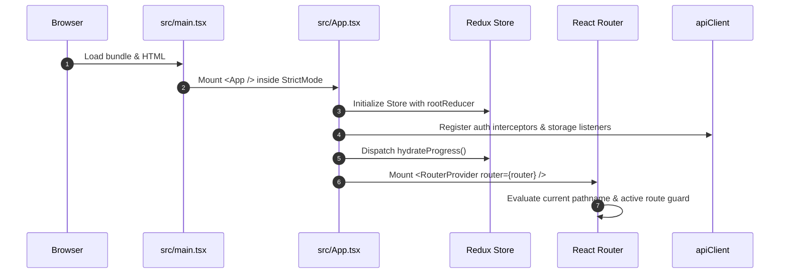

# 02. Architecture & Coding Conventions

## 1. Directory Structure & Repository Map

The repository is organized into distinct layer boundaries:

```text
Connect-2-code/
├── .agents/                      # Agent workflows, rules, and skills
│   ├── rules/brand-logo.md       # Official brand logo & asset usage policy
│   └── rules/graphify.md         # Graphify knowledge graph rules
├── .github/workflows/
│   └── frontend-ci.yml           # CI workflow (lint, arch check, audit, typecheck, build, preview)
├── docs/
│   ├── api/                      # Historical API documentation & inventory
│   └── project/                  # Authoritative permanent documentation (01-10)
├── public/
│   ├── companies/                # 121 local SVG/PNG company recruiter logos
│   ├── favicon.ico               # Official brand favicons
│   ├── logo-full.png             # Official full brand logo
│   └── logo-mark.png             # Official brand mark
├── scripts/
│   ├── smoke-preview.mjs         # Production preview build route & asset verification
│   ├── verify-architecture.mjs   # AST & string check for banned imports/patterns
│   ├── verify-documentation.mjs  # Documentation integrity and link validator
│   └── tests/                    # 15 Node test runner test suites (192 passing tests)
├── src/
│   ├── App.tsx                   # Top-level providers, theme, toast, error boundary
│   ├── main.tsx                  # React 19 entry point and DOM mounting
│   ├── index.css                 # Tailwind v4 import, design tokens, dark/light variables
│   ├── vite-env.d.ts             # Vite client environment typing
│   ├── app/                      # Redux store configuration & typed hooks
│   │   ├── hooks.ts              # useAppDispatch and useAppSelector
│   │   ├── rootReducer.ts        # Combined root reducer (8 slices)
│   │   └── store.ts              # configureStore instance
│   ├── core/                     # Shared cross-cutting domain primitives
│   │   ├── api/                  # apiClient.ts, endpoints.ts
│   │   ├── guards/               # AdminRoute.tsx, GuestRoute.tsx, ProtectedRoute.tsx
│   │   ├── mappers/              # problemMapper.ts
│   │   ├── security/             # jwt.ts, tokenStorage.ts
│   │   ├── storage/              # userScopedStorage.ts
│   │   ├── types/                # api.ts, domain.ts
│   │   └── validation/           # commonRules.ts, serverErrorMapper.ts, schemas/
│   ├── features/                 # Modular domain feature slices
│   │   ├── admin/                # Admin portal pages, modals, tables, and dashboards
│   │   ├── aptitude/             # MCQ practice, mock tests, and mcqUtils
│   │   ├── auth/                 # Login, Signup, ForgotPassword, OAuthCallback
│   │   ├── bookmarks/            # User saved problem bookmarks
│   │   ├── companies/            # Company catalog, recruitment exams, and logos
│   │   ├── dsaSheet/              # API-driven DSA sheets, sections, and linked questions
│   │   ├── institutions/         # Student registration college autocomplete
│   │   ├── interviews/           # Curated interview preparation hub
│   │   ├── landing/              # High-conversion public landing page
│   │   ├── languages/            # Language reference and compiler slice
│   │   ├── problems/             # Practice catalog, problem details, and Monaco editor
│   │   ├── profile/              # User profile, academic info, and KPI statistics
│   │   ├── progress/             # Solved and attempted question progress slice
│   │   ├── references/           # Dynamic taxonomy groups (DIFF, TOPIC, QPF)
│   │   ├── roadmaps/             # Engineering preparation roadmaps
│   │   └── settings/             # Application settings & appearance
│   ├── layouts/                  # AppRouterLayout.tsx, AuthLayout.tsx, MainLayout.tsx
│   ├── routes/                   # appRoutes.tsx (createBrowserRouter definition)
│   ├── services/                 # Frontend service layer mediating between UI and API
│   │   ├── admin/                # Admin-specific service implementations
│   │   └── ...                   # authService, problemService, executionService, etc.
│   └── shared/                   # Generic UI components, modals, and context
│       ├── components/           # UI elements (Button, Badge, Navbar, Footer, etc.)
│       └── context/              # ThemeContext.tsx
├── package.json                  # Dependencies and execution scripts
├── vite.config.ts                # Vite config (plugins, path alias '@', proxying)
├── tsconfig.json                 # TypeScript compiler options
└── vercel.json                   # Edge routing and SPA fallback rewrite
```

---

## 2. Core Architectural Principles

### A. The Single API Transport Rule
All HTTP communication MUST go through `apiClient` in [`src/core/api/apiClient.ts`](../../src/core/api/apiClient.ts).
- **Prohibited**: Direct imports of `axios` outside `src/core/api/apiClient.ts`.
- **Prohibited**: Direct calls to `window.fetch()` in UI components or feature code.
- **Enforcement**: [`scripts/verify-architecture.mjs`](../../scripts/verify-architecture.mjs) scans all files in `src/` and fails CI if direct `axios` or `fetch()` calls exist.

### B. Path Aliasing
Use `@/` to import from `src/` where appropriate, configured in `vite.config.ts`:
```ts
resolve: {
  alias: {
    '@': path.resolve(import.meta.dirname, './src')
  }
}
```

### C. Pure Determinism & No Mock Data in Production
- Do NOT use `Math.random()` to generate fake data, fake question IDs, or sample outputs.
- Never use fake test cases or client-side mock modes. Always query the backend or handle API errors gracefully via `serverErrorMapper.ts`.

### D. Safe Multi-Tenant Browser Storage
Browser `localStorage` is shared across tabs and sessions. To prevent one user from seeing another user's bookmarks or solved problem progress:
- Always use [`src/core/storage/userScopedStorage.ts`](../../src/core/storage/userScopedStorage.ts).
- It computes a fast 32-bit FNV-1a hash of the logged-in user's identity (`id:<userId>` or `email:<email>`), isolating stored keys as `c2c:user:<hash>:<key>`. Unauthenticated users use the `guest` scope.

---

## 3. Entry Points & Initialization Lifecycle



1. **`index.html`**: Defines the `<div id="root"></div>` container, loads Google Fonts (`Plus Jakarta Sans`, `Inter`, `JetBrains Mono`), and sets initial theme script to prevent light-theme flash.
2. **`src/main.tsx`**: Obtains `#root`, validates DOM presence, and mounts `<App />` within React `StrictMode`.
3. **`src/App.tsx`**: Wraps the tree with:
   - `<Provider store={store}>` (Redux)
   - `<ProgressHydrator />` (hydrates solved/attempted problem IDs per user scope)
   - `<ThemeProvider>` (light/dark class on `<html>`)
   - `<Toaster>` (react-hot-toast with custom glassmorphism styles)
   - `<AppErrorBoundary>` (catches runtime rendering crashes)
   - `<RouterProvider router={router} />` (React Router v7)

---

## 4. Coding Conventions & Best Practices

1. **TypeScript Typing**:
   - Avoid `any` wherever possible. Define explicit DTO interfaces in `src/core/types/` or feature-specific types.
   - For unknown API returns, use `unknown` and validate with Zod or type guards.
2. **Component Structure**:
   - Keep components focused and modular.
   - Separate complex data-fetching or modal logic into subcomponents (e.g. `src/features/admin/components/`).
3. **Icons & UI Assets**:
   - Use `lucide-react` for standard UI iconography.
   - Use `<BrandLogo />` for all Connect2Code branding.
   - Use `<CompanyBrandLogo />` for recruiter logos. It serves known brands from `public/companies/` and owns the reviewed dynamic fallback cascade; feature components must not render backend logo URLs directly.
4. **Form Management**:
   - Use `react-hook-form` with `@hookform/resolvers/zod`.
   - Pass validation schemas from `src/core/validation/`.
   - Use `FormFieldError` component to display validation messages consistently.
