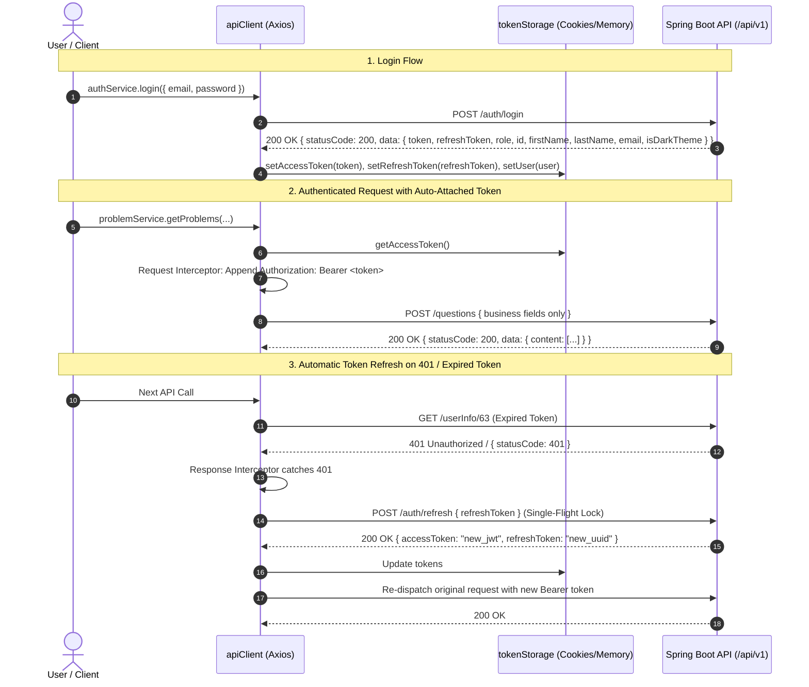

# 05. API Contracts, Authentication & Security

## 1. Backend Origin & Base URL Resolution

- **Production API Origin**: `https://api.connect2code.in`
- **Canonical API Base URL**: `https://api.connect2code.in/api/v1`
- **Base URL Resolution Logic** ([`src/core/api/apiClient.ts`](../../src/core/api/apiClient.ts)):
  ```ts
  export const resolveDeploymentApiBaseUrl = (rawUrl?: string | null, isLocal?: boolean): string => {
    const resolved = resolveApiBaseUrl(rawUrl);
    const isLocalEnv = typeof isLocal === 'boolean' ? isLocal : ...;

    // In local dev/preview: preserve relative paths (/api/v1) for Vite proxy and local backends (localhost)
    if (isLocalEnv) return resolved;

    // In deployed production: guard against localhost/relative paths and fallback to canonical backend
    if (resolved.includes('localhost') || resolved.includes('127.0.0.1') || !resolved.startsWith('http')) {
      return DEFAULT_API_BASE_URL; // 'https://api.connect2code.in/api/v1'
    }
    return resolved;
  };
  ```

---

## 2. Authentication Architecture & Token Lifecycle

Connect2Code uses stateless **JWT Bearer access tokens** combined with **refresh tokens** managed via HTTP requests and client-side cookie storage.



### Storage Security Architecture (`tokenStorage.ts`)
- **Access Token**: Maintained in memory and fallback cookie (`accessToken`).
- **Refresh Token**: Stored in cookie (`refreshToken`).
- **Cookie Security Attributes**: Automatically appends `; Secure` on HTTPS origins and `SameSite=Lax`.
- **No Web-Storage Credentials**: `tokenStorage` does not read or write access tokens, refresh tokens, or user profiles in `localStorage` or `sessionStorage`; it removes legacy copies when a session is written or cleared.
- **Immediate Logout Hygiene**: Logout captures the refresh token, increments the local session epoch, clears memory/cookies/web-storage aliases, and broadcasts the cleared state before waiting for the backend. Cookie deletion uses both `Max-Age=0` and a past `Expires` date across canonical, legacy, current-route, API-route, host, and parent-domain scopes.
- **Stale-Response Rejection**: Login and refresh responses capture the session epoch and cannot restore credentials after a logout that completed while their request was in flight.
- **Expired-Access Startup**: An expired access token with a refresh token/profile keeps authentication in `LOADING` until the one bootstrap refresh completes, preventing a premature protected-route redirect.
- **Environment parity**: JWT expiry uses the token's `exp` claim identically on localhost and deployed origins, so development requests proactively refresh instead of sending access tokens that are already expired.
- **Single-Flight Refresh Lock**: `executeRefreshToken()` uses a shared promise variable `refreshTokenPromise`. If multiple concurrent requests receive a 401 simultaneously, only ONE refresh request is dispatched to the backend; all waiting callers resolve with the new access token.
- **Cross-Tab Session Reconciliation**: [`src/core/security/authSessionSync.ts`](../../src/core/security/authSessionSync.ts) sends credential-free `session-updated` and `session-cleared` events through `BroadcastChannel`, with a transient storage-event fallback only where that browser API is unavailable. Receiving tabs discard their in-memory token cache, then restore from the shared cookies or immediately become unauthenticated. A logout, refresh failure, sign-in, or refresh therefore cannot leave another open tab with stale Redux authentication state.

---

## 3. Bearer-Only JWT Contract

### The Problem
Historically, the client sent `jwtToken` in mutating request bodies in addition to the bearer header. Authenticated production probes on 2026-11-03 proved that this was unnecessary and incorrect: bearer-only requests returned HTTP 200, while otherwise identical body-token-only requests returned HTTP 401 for `/questions`, `/mcq`, and `/company/list`.

### The Solution: Non-Mutating Canonicalization in `apiClient.ts`
[`src/core/api/apiClient.ts`](../../src/core/api/apiClient.ts) implements `sanitizeRequestData` over a recursive clone. For every outgoing request body:

1. The caller-owned body remains unchanged while a recursive clone removes `jwtToken`, `token`, `jwttoken`, and `jwt_token`, including nested objects, arrays, `FormData`, and `URLSearchParams`.
2. The access token is attached only as `Authorization: Bearer <token>`.
3. DELETE without business data remains bodyless.
4. URL query parameters are checked so credentials are never exposed in URLs.
5. `URLSearchParams` bodies remain form-encoded and preserve repeated business fields after credential removal.

---

## 4. REST Endpoint Catalog & Method Mappings

### A. Authentication Endpoints ([`src/services/authService.ts`](../../src/services/authService.ts))
| Endpoint | Method | Access | Request Body | Response Envelope |
| :--- | :---: | :--- | :--- | :--- |
| `/signUp` | `POST` | `PUBLIC` | `{ firstName, lastName, email, password, role: "USER", labelUserName, userName }` | `ApiResponse<AuthResponseData>` |
| `/auth/login` | `POST` | `PUBLIC` | `{ email, password }` | `ApiResponse<{ token, refreshToken, role, id, firstName, lastName, email, isDarkTheme }>` (read-only production capture, 2026-10-23) |
| `/auth/refresh` | `POST` | `SESSION_RENEWAL` (refresh token only; no access JWT) | `{ refreshToken }` | `ApiResponse<{ token, refreshToken }>`; `authService` normalizes `token` as the access token |
| `/auth/logout` | `POST` | `PUBLIC` | `{ refreshToken }` | `ApiResponse<string>` |
| `/auth/generatePasswordResetOtp` | `POST` | `PUBLIC` | `{ email }` | `ApiResponse<unknown>` |
| `/auth/verifyPasswordResetOtp` | `POST` | `PUBLIC` | `{ email, otp, password }` | `ApiResponse<unknown>` |

`/auth/logout` remains a public-auth transport endpoint: the client clears its local session immediately, then sends the captured refresh token with credentials so the backend can invalidate the server session and expire any HttpOnly refresh cookie. Browser JavaScript cannot delete an HttpOnly cookie or revoke an already-issued stateless access JWT server-side; the backend owns those operations, while the client removes every readable credential and prevents stale responses from restoring it.

### B. Problems & Questions ([`src/services/problemService.ts`](../../src/services/problemService.ts), [`src/services/questionService.ts`](../../src/services/questionService.ts))
| Endpoint | Method | Access | Description / Payload |
| :--- | :---: | :--- | :--- |
| `/questions` | `POST` | `USER_OR_ADMIN` | Paginated search: `{ level: number[], companies: number[], topic: number[], searchText: string, pageRequest: { pageNumber, pageSize, sortBy, sortDirection } }` |
| `/question/{id}` | `GET` | `USER_OR_ADMIN` | Numeric problem detail route. A request for a current catalog ID returned a backend `HttpResponseException` on 2026-10-23; callers retain the catalog fallback and this endpoint is not currently runtime-verified. |
| `/question` | `POST` | `ADMIN_ONLY` | Creates/updates problem with title, description, constraints, hints, and tax references. |
| `/question/{id}/testCases` | `POST` | `ADMIN_ONLY` | Attaches array of test cases (`input`, `expectedOutput`, `isHidden`, `displayOrder`). Direct `GET` is attempted by `adminQuestionService.getTestCases` for admins and falls back to question details. Catalog fallback does not issue speculative test-case reads. Test cases, including hidden cases, remain backend-owned: failed mutations remain errors and must never fall back to browser storage or static client fixtures. |

### C. Code Execution Engine ([`src/services/executionService.ts`](../../src/services/executionService.ts))
| Endpoint | Method | Access | Description / Payload |
| :--- | :---: | :--- | :--- |
| `/runCode` | `POST` | `USER_OR_ADMIN` | User RUN: executes visible sample test cases. Payload: `{ questionId: number, languageId: number (Ref ID 5-8), sourceCode: string, customInput?: string }`; `customInput` is included only for the explicit custom-input action. |
| `/submitCode` | `POST` | `USER_OR_ADMIN` | User SUBMIT: runs all test cases (visible, hidden, edge). *Remote backend has observed NPE bug on `TestCase.getType()`.* |
| `/admin/testCode` | `POST` | `ADMIN_ONLY` | Admin RUN: runs sample test cases without saving submission history. |
| `/admin/submitCode` | `POST` | `ADMIN_ONLY` | Admin SUBMIT: runs all test cases without saving submission history. |

`ProblemDetails` invalidates and refetches submission history after a completed user submission. It does not synthesize a local history row or store submitted source code/results in browser storage.

`executionService` normalizes only the execution response fields returned by the API (`totalTestCases`, pass/fail counts, optional runtime/memory, and `testCases`). A successful HTTP response must still contain a recognizable verdict, and solved/success UI requires at least one executed and passed test with zero failures; zero-test or malformed responses are rejected instead of being reported as accepted.

### D. Recruiter Companies & Exams ([`src/services/companyService.ts`](../../src/services/companyService.ts), [`src/services/admin/adminCompanyService.ts`](../../src/services/admin/adminCompanyService.ts))
| Endpoint | Method | Access | Description / Payload |
| :--- | :---: | :--- | :--- |
| `/company/list` | `POST` | `USER_OR_ADMIN` | Service payload: `{ pageNumber, pageSize, sortBy, sortDirection }` with bearer authentication. The response page uses `content`, `pageNumber`, `pageSize`, `totalElements`, `totalPages`, `first`, and `last`. Captured records contain `id`, `name`, `logo`, `website`, and `isActive`. Live 2026-11-03 probes confirmed pagination and also confirmed that `searchText`, `search`, `query`, `name`, and `companyName` are silently ignored; they must not be exposed as server filters. |
| `/company/{id}` | `GET` | `USER_OR_ADMIN` | Company details by numeric ID; captured records contain `id`, `name`, `logo`, `website`, and `isActive`. |
| `/company/{companyId}/exams/list` | `POST` | `USER_OR_ADMIN` | Services send pagination/sort business fields with bearer authentication. |
| `/company/exams/{examId}` | `GET` | `USER_OR_ADMIN` | Detailed exam blueprint (exam info, recruitment roles, exam sections). |
| `/admin/company` | `POST` | `ADMIN_ONLY` | Creates or updates company record. |
| `/admin/companyRole` | `POST` | `ADMIN_ONLY` | Creates or updates recruitment role (`roleName`, `roleCode`, `salary`). |
| `/admin/examSection` | `POST` | `ADMIN_ONLY` | Creates or updates an exam section / round. `sectionTypeId` and optional `questionTypeId` must be selected from `EXAM SECTION TYPE` and `QUESTION TYPE`; no legacy numeric fallback is permitted. |
| `/admin/companyExam` | `POST` | `ADMIN_ONLY` | Creates or updates company exam schedule (`examName`, `year`, `totalDurationMinutes`). |

### E. Aptitude & MCQ Assessment ([`src/services/mcqService.ts`](../../src/services/mcqService.ts), [`src/services/admin/adminMcqService.ts`](../../src/services/admin/adminMcqService.ts))
| Endpoint | Method | Access | Description / Payload |
| :--- | :---: | :--- | :--- |
| `/mcq` | `POST` | `USER_OR_ADMIN` | Query MCQs by `subject`, `difficulty`, `topic`, `companies`, and `searchText`, with `pageRequest`. Reference filters send numeric IDs loaded from the reference library. Live 2026-11-03 probes returned 86 total rows and different totals for search queries. |
| `/mcq/{id}` | `GET` | `USER_OR_ADMIN` | Single MCQ question details and options. |
| `/admin/mcq` | `POST` | `ADMIN_ONLY` | Admin create/update MCQ. The request contains `id` for an update, taxonomy codes and names (`subjectGroupCode`, `subjectRefCode`, `subjectRefName`, `topicGroupCode`, `topicRefCode`, `topicRefName`, `difficultyGroupCode`, `difficultyRefCode`, `difficultyRefName`), optional `companyId` and `companyName`, `question`, optional `explanation`, `isActive`, and `options`. Each option contains only its persisted `id` when present, `optionLabel`, `optionText`, and explicit `isCorrect: true/false`. Exactly one option must be correct. Legacy question-level answer fields and option aliases are not sent or used to determine correctness. |
| `/admin/mcq/{id}` | `DELETE` | `ADMIN_ONLY` | Deletes an MCQ question. |

User-facing MCQ reads remain in `mcqService`; create/update/delete operations exist only in the admin service and admin-routed UI. Because the backend uses one `POST` route for both create and update, endpoint constants and payload types use `SAVE` naming rather than the obsolete create-only name.

### F. DSA Learning Sheets ([`src/services/learningSheetService.ts`](../../src/services/learningSheetService.ts), [`src/services/admin/adminLearningSheetService.ts`](../../src/services/admin/adminLearningSheetService.ts))

The backend names this resource `learningSheet`; the product UI intentionally presents it only as **DSA Sheet**.

| Endpoint | Method | Access | Description / Payload |
| :--- | :---: | :--- | :--- |
| `/user/learningSheets` | `GET` | `USER_OR_ADMIN` | Lists sheets with `id`, `sheetCode`, `sheetName`, `description`, and `isActive`. |
| `/user/learningSheets/{sheetId}/sections` | `GET` | `USER_OR_ADMIN` | Returns top-level sections. The client retains only `parentSectionId: null` and orders by `displayOrder`, then `id`. |
| `/user/learningSheet/section/{sectionId}/questions` | `GET` | `USER_OR_ADMIN` | Returns question-link records ordered by `displayOrder`. The deletion identifier is the outer link `id`; problem navigation uses `question.id`. |
| `/admin/learningSheet` | `POST` | `ADMIN_ONLY` | Saves a sheet. Create omits `id`; edit sends `{ id, sheetCode, sheetName, description, isActive }`. |
| `/admin/learningSheet/section` | `POST` | `ADMIN_ONLY` | Saves a top-level section. Create omits `id`; edit sends `{ id, sheetId, parentSectionId, sectionName, displayOrder, isActive }`. |
| `/admin/learningSheet/section/{sectionId}` | `DELETE` | `ADMIN_ONLY` | Deletes a section with bearer authentication and no invented credential body. |
| `/admin/learningSheet/question` | `POST` | `ADMIN_ONLY` | Saves a problem association: create sends `id: null`; edit sends the outer association `id`, plus `{ sectionId, question: { id }, displayOrder, isActive }`. |
| `/admin/learningSheet/section/{sectionId}/question/{linkId}` | `DELETE` | `ADMIN_ONLY` | Removes a section-question association without deleting the problem. The second path value is the association/link ID returned as the outer record `id`. |

The problem route is deliberately built from the nested `question.id`, never the outer association `id` and never the nullable response `sectionId`. The production OpenAPI document requires authentication and could not be read anonymously on 2026-11-01; therefore live update acceptance remains `PARTIALLY VERIFIED` until an authenticated edit is executed against the backend.

All calls use `apiClient`. Protected business requests carry the access JWT only in the bearer header; access-token aliases are removed from request bodies and query parameters. The session-specific `/auth/refresh` and `/auth/logout` contracts intentionally retain `{ refreshToken }` in their request bodies.

### G. Live Read-Only DTO Fields (2026-10-23)

The following fields were captured from the configured production API using supplied test credentials. They are evidence for read paths only; admin mutation payloads were not sent to production. A follow-up Postman MCP run on 2026-11-01 authenticated successfully and runtime-verified the reference group-code catalog; the per-group request exposed the backend cache failure documented in the known-issues register.

| Endpoint | Captured `data` fields |
| :--- | :--- |
| `GET /language` | `id`, `referenceId`, `languageName`, `judge0LanguageId`, `version`, `isActive` |
| `GET /language/dropdown` | `id`, `name` (a distinct dropdown DTO) |
| `GET /referenceLibrary/refGroupCode/{group}` | `id`, `refGroupCode`, `refCode`, `refName`, `isActive` |
| `GET /referenceLibrary/refGroupCode/list` | Array of reference group-code strings |
| `POST /referenceLibrary` | `id`, `refGroupCode`, `refCode`, `refName`, `isActive` (`refGroupName` is accepted on create but omitted from the observed response) |
| `POST /mcq`, `GET /mcq/{id}` | Question: `subjectGroupCode`, `subjectRefCode`, `subjectRefName`, `topic*`, `difficulty*`, `companyName`, `companyId`, `question`, `explanation`, `isActive`, `options`, `id`; option: `id`, `optionLabel`, `optionText`, `isCorrect` |
| `POST /questions` | `id`, `title`, `description`, `difficultyId`, `difficultyName`, `topicId`, `topicName`, `isOwnProblem`, `isActive`, `companies`, `questionPlatform` |
| `GET /users/{id}/questions/bookmarks` | `questionId`, `title`, `difficulty` |
| `GET /{id}/getSubmiteedQuestionIds` | `questionId`, `questionName`, `difficultyLevel`, `submittedDate` |
| `GET /{id}/getAPttemptedQuestionIds` | `questionId`, `title`, `difficulty`, `submittedDate` |
| `GET /institutions/search` | `id`, `name`, `institutionType`, `state`, `district` |
| `GET /admin/institutions`, `GET /admin/institutions/{id}` | `id`, `aisheCode`, `name`, `institutionType`, `state`, `district`, `website`, `yearOfEstablishment`, `location`, `collegeType`, `management`, `universityId`, `universityName`, `universityType`, `isActive`, audit timestamps/IDs |

Live MCQ verification on 2026-10-23 found that this is a record-level data boundary: a ten-record `POST /mcq` response had option counts `4, 4, 4, 0, 0, 0, 0, 0, 0, 0`, and an affected record's `GET /mcq/4` returned the same empty `options` array. The aptitude renderer intentionally shows no selectable answers for those records; it must not manufacture option text or correctness from question-level aliases.

### G. Endpoint Coverage Boundary

`src/core/api/endpoints.ts` contains only routes with a current service caller. The unused `company/{id}/problems`, `question/{id}/submit`, `/institutions` base, `/language/dropdown`, and duplicate solved-question constant were removed during the source audit rather than represented as working integrations. `/language/dropdown` was captured but intentionally omitted because it supplies only `id` and `name`, whereas code execution requires the `referenceId` supplied by `GET /language`. Read-only routes listed above have direct production evidence. `GET /institutions/{id}` and `GET /question/{id}/testCases` returned `401` under the authenticated temporary account; `GET /question/{id}` returned a backend `500` for a current catalog ID. Create, update, delete, refresh, reset, and execution requests are preserved at their existing callers but remain `PARTIALLY VERIFIED` until a disposable non-production fixture is available; this audit did not mutate production data.

### H. Envelope and Detail Rules

`apiClient` is typed as an unwrapped transport and returns the backend envelope directly, so services and UI callers consume the payload exactly once through `response.data`; user and admin MCQ/question/dashboard views do not attempt raw-response or nested `data.data` fallbacks. `POST /questions` rows are mapped only from captured list fields. They are not converted into full `Question` detail records, because the list DTO lacks the reference and test-case fields required for authoring. When `GET /question/{id}` fails, the admin/detail UI reports that API failure instead of showing guessed taxonomy, platform, or test cases.

### F. User Profile, Bookmarks & Academic Details ([`src/services/profileService.ts`](../../src/services/profileService.ts), [`src/services/userQuestionService.ts`](../../src/services/userQuestionService.ts))
| Endpoint | Method | Access | Description / Payload |
| :--- | :---: | :--- | :--- |
| `/userInfo/{userId}` | `GET` | `USER_OR_ADMIN` | Fetches academic details (regNumber, joinedYear, passedOutYear, college). |
| `/userInfo/{userId}` | `POST` | `USER_OR_ADMIN` | Saves/updates academic details using business fields and bearer authentication. |
| `/users/{userId}/questions/{questionId}/bookmark` | `POST` | `USER_ONLY` | Bookmarks a problem for the user. |
| `/users/{userId}/questions/{questionId}/bookmark` | `DELETE` | `USER_ONLY` | Removes a problem bookmark. |
| `/users/{userId}/questions/bookmarks` | `GET` | `USER_ONLY` | Retrieves all bookmarked questions for the user. |
| `/{userId}/getSubmiteedQuestionIds` | `GET` | `USER_ONLY` | Solved problem IDs for progress tracking. (Backend typo preserved: `getSubmiteedQuestionIds`). |
| `/{userId}/getAPttemptedQuestionIds` | `GET` | `USER_ONLY` | Attempted problem IDs. (Backend typo preserved: `getAPttemptedQuestionIds`). |
| `/{userId}/question/{questionId}/getSubmissions` | `GET` | `USER_ONLY` | Submissions history for a specific problem. |

Academic records are server-owned: `ProfileSettings` reads and writes them through `/userInfo/{userId}` and does not retain an offline `localStorage` copy. A legacy `c2c_user_academic_<userId>` value is removed when that profile is opened.

Problem bookmarks are server-owned. `bookmarkSlice` hydrates only `questionId`, `title`, and `difficulty` from `GET /users/{userId}/questions/bookmarks`; a failed refresh preserves the active user's last known server list and exposes an error instead of replacing it with a false empty success. COMPANY/APTITUDE bookmarks have no observed API contract and are therefore retained only in `userScopedStorage`; server-owned problem bookmarks are excluded from browser persistence.

`GET` and `PUT /user/profile` are not used: archived direct probes returned 401 for every available credential and identified the route as unmapped. The client therefore does not fabricate successful identity or avatar mutations in browser storage. Name/email remain session-owned and read-only; avatar editing is disabled. Personal fields supported by `userInfo` are saved only when the required academic fields already exist, so the client never invents registration, college, or year values to satisfy the POST contract.

### G. Institution Directory ([`src/services/institutionService.ts`](../../src/services/institutionService.ts), [`src/services/admin/adminInstitutionService.ts`](../../src/services/admin/adminInstitutionService.ts))
| Endpoint | Method | Access | Description / Payload |
| :--- | :---: | :--- | :--- |
| `/institutions/search` | `GET` | `PUBLIC` | Query param `?query=...` (min 3 chars). Autocomplete for college selection. |
| `/institutions/{id}` | `GET` | `PUBLIC` | Public institution details. |
| `/admin/institutions` | `GET` | `ADMIN_ONLY` | Paginated admin list with query, type, state, district, activeOnly filters. |
| `/admin/institutions/{id}` | `GET` | `ADMIN_ONLY` | Institution details including affiliated university. |
| `/admin/institutions` | `POST` | `ADMIN_ONLY` | Creates new college or university with AISHE code. |
| `/admin/institutions/{id}` | `PUT` | `ADMIN_ONLY` | Updates existing institution details. |
| `/admin/institutions/{id}/status` | `PATCH` | `ADMIN_ONLY` | Soft toggle: `{ isActive: boolean }`. |

### H. Compiler Languages & Taxonomy ([`src/services/referenceService.ts`](../../src/services/referenceService.ts), [`src/services/admin/adminReferenceService.ts`](../../src/services/admin/adminReferenceService.ts), [`src/services/admin/adminLanguageService.ts`](../../src/services/admin/adminLanguageService.ts))
| Endpoint | Method | Access | Description / Payload |
| :--- | :---: | :--- | :--- |
| `/referenceLibrary/refGroupCode/{groupCode}` | `GET` | `USER_OR_ADMIN` | Returns API-owned taxonomy terms. Current callers request `DIFF`, `TOPIC`, `QPF`, `SUBJECT`, subject-specific topic groups, `GENDER`, `LANG`, and `TESTCASETYPE`. |
| `/referenceLibrary/refGroupCode/list` | `GET` | `USER_OR_ADMIN` | Returns all reference group codes as strings. The authenticated 2026-11-01 response contained 15 codes; clients consume the returned list rather than hardcoding its length or membership. |
| `/referenceLibrary` | `POST` | `ADMIN_ONLY` | Creates when no `id` is present using `{ refGroupCode, refGroupName, refCode, refName, isActive }`; updates when `id` is present using `{ id, refGroupCode, refCode, refName, isActive }`. Authentication is bearer-header only. A group is created by saving its first record. |
| `/referenceLibrary/refGroupCode/{groupCode}/refCode/{refCode}` | `DELETE` | `ADMIN_ONLY` | Irreversible hard delete. The admin UI requires an explicit confirmation and URL-encodes both path segments. |
| `/language` | `GET` | `USER_OR_ADMIN` | Compiler catalog with database table IDs and execution reference IDs. Values are consumed from response fields, not fixed client ranges. |
| `/language/dropdown` | `GET` | `USER_OR_ADMIN` | Lightweight language selector for code runner. |
| `/language` | `POST` | `ADMIN_ONLY` | Registers or updates language compiler configuration. |
| `/language/{id}` | `DELETE` | `ADMIN_ONLY` | Soft deletes language compiler configuration. |

The response interceptor returns the backend `ApiResponse<T>` envelope itself, not an Axios response wrapper. Services therefore consume `response.data` exactly once. List services reject malformed successful payloads rather than silently converting them into empty arrays. Reference group paths are URL-encoded (including group names containing spaces), and every returned reference record is validated for numeric `id`, matching `refGroupCode`, non-empty `refCode`/`refName`, and boolean `isActive`. Component-level group-record reads use the shared Redux reference cache with a 30-minute TTL, in-flight deduplication, and request ownership; the group-code catalog is read through the same validated reference service. An API-confirmed empty list is cacheable. Successful reference-library mutations invalidate the affected Redux reference group, while language create/update/delete operations invalidate both Redux and execution-service caches so Monaco/code execution cannot retain obsolete mappings. Public institution-search failures are surfaced to the autocomplete instead of being converted into a false successful empty result.

---

## 5. Security & Error Sanitization

### Error Sanitization (`serverErrorMapper.ts`)
The backend is built with Java Spring Boot and Hibernate. When internal exceptions occur, raw error messages may contain Java package paths (`org.springframework`, `java.lang`), database table names, or SQL constraint violations.
- [`src/core/validation/serverErrorMapper.ts`](../../src/core/validation/serverErrorMapper.ts) tests error text against `isInternalServerLeak()`.
- If an internal leak is detected, it suppresses the technical trace and presents clean, actionable user feedback (e.g. *"Our servers encountered an issue while processing your request. Please try again shortly."*).
- Prevents database column names, Java stack traces, and internal server topologies from being revealed to end users.
