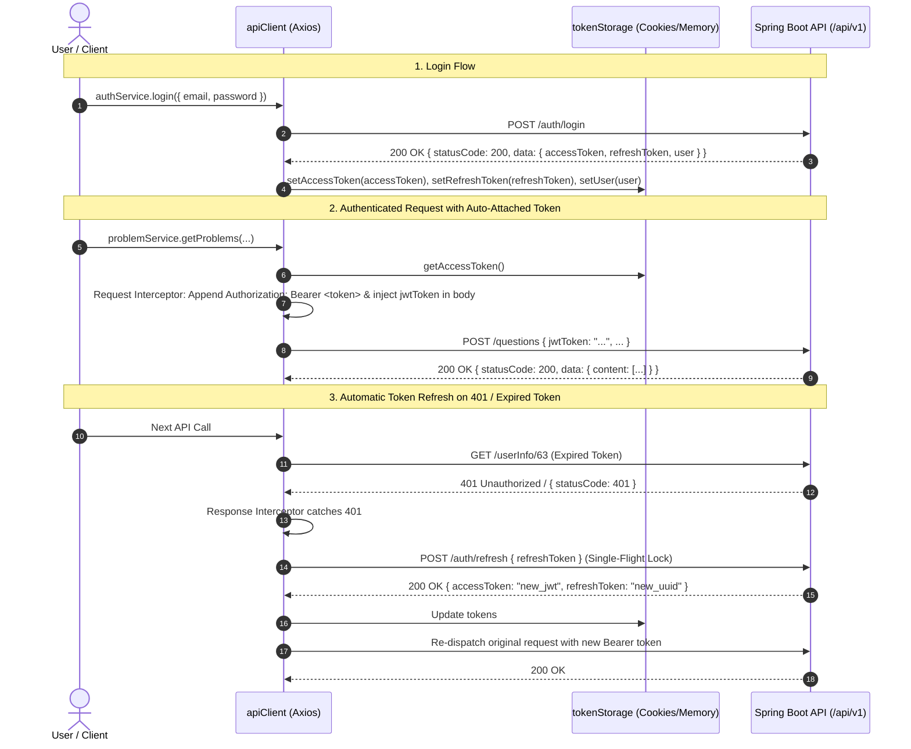

# 05. API Contracts, Authentication & Security

## 1. Backend Origin & Base URL Resolution

- **Production API Origin**: `https://api.connect2code.in`
- **Canonical API Base URL**: `https://api.connect2code.in/api/v1`
- **Base URL Resolution Logic** ([`src/core/api/apiClient.ts`](file:///c:/Users/sakha/Pictures/Connect-2-code/src/core/api/apiClient.ts)):
  ```ts
  export const resolveDeploymentApiBaseUrl = (rawUrl?: string | null, _isLocal: boolean = false): string => {
    const resolved = resolveApiBaseUrl(rawUrl);
    // In all environments, ALL API calls strictly target the live backend origin
    if (resolved.includes('localhost') || resolved.includes('127.0.0.1') || !resolved.startsWith('http')) {
      return DEFAULT_API_BASE_URL; // 'https://api.connect2code.in/api/v1'
    }
    return resolved;
  };
  ```

---

## 2. Authentication Architecture & Token Lifecycle

Connect2Code uses stateless **JWT Bearer access tokens** combined with **refresh tokens** managed via HTTP requests and client-side cookie storage.



### Storage Security Architecture (`tokenStorage.ts`)
- **Access Token**: Maintained in memory and fallback cookie (`accessToken`).
- **Refresh Token**: Stored in cookie (`refreshToken`).
- **Cookie Security Attributes**: Automatically appends `; Secure` on HTTPS origins and `SameSite=Lax`.
- **No Web-Storage Credentials**: `tokenStorage` does not read or write access tokens, refresh tokens, or user profiles in `localStorage` or `sessionStorage`; it removes legacy copies when a session is written or cleared.
- **Expired-Access Startup**: An expired access token with a refresh token/profile keeps authentication in `LOADING` until the one bootstrap refresh completes, preventing a premature protected-route redirect.
- **Single-Flight Refresh Lock**: `executeRefreshToken()` uses a shared promise variable `refreshTokenPromise`. If multiple concurrent requests receive a 401 simultaneously, only ONE refresh request is dispatched to the backend; all waiting callers resolve with the new access token.
- **Cross-Tab Session Reconciliation**: [`src/core/security/authSessionSync.ts`](../../src/core/security/authSessionSync.ts) sends credential-free `session-updated` and `session-cleared` events through `BroadcastChannel`, with a transient storage-event fallback only where that browser API is unavailable. Receiving tabs discard their in-memory token cache, then restore from the shared cookies or immediately become unauthenticated. A logout, refresh failure, sign-in, or refresh therefore cannot leave another open tab with stale Redux authentication state.

---

## 3. The `jwtToken` Payload Contract

### The Problem
Historically, some services sent a payload field named `token` while others sent `jwtToken`, or both. The backend strictly expects `jwtToken` and throws validation errors if duplicate or conflicting token fields are present.

### The Solution: Deep Purge in `apiClient.ts`
[`src/core/api/apiClient.ts`](file:///c:/Users/sakha/Pictures/Connect-2-code/src/core/api/apiClient.ts) implements `purgeDuplicateTokenFields`:
```ts
function purgeDuplicateTokenFields(obj: any): void {
  if (!obj || typeof obj !== 'object' || obj instanceof FormData) return;
  if (Array.isArray(obj)) {
    for (const item of obj) purgeDuplicateTokenFields(item);
    return;
  }
  for (const key of Object.keys(obj)) {
    const lowerKey = key.toLowerCase();
    if (lowerKey === 'token' || (lowerKey === 'jwttoken' && key !== 'jwtToken') || lowerKey === 'jwt_token') {
      delete obj[key];
    } else if (typeof obj[key] === 'object' && obj[key] !== null) {
      purgeDuplicateTokenFields(obj[key]);
    }
  }
}
```
In every outgoing `POST`, `PUT`, `PATCH`, or `DELETE` request:
1. `purgeDuplicateTokenFields` recursively removes any `token`, `jwttoken`, or `jwt_token` keys.
2. The logged-in user's active access token is attached strictly as `jwtToken`.
3. URL query parameters are checked to ensure no token is ever exposed in query strings.

---

## 4. REST Endpoint Catalog & Method Mappings

### A. Authentication Endpoints ([`src/services/authService.ts`](file:///c:/Users/sakha/Pictures/Connect-2-code/src/services/authService.ts))
| Endpoint | Method | Access | Request Body | Response Envelope |
| :--- | :---: | :--- | :--- | :--- |
| `/signUp` | `POST` | `PUBLIC` | `{ firstName, lastName, email, password, role: "USER", labelUserName, userName }` | `ApiResponse<AuthResponseData>` |
| `/auth/login` | `POST` | `PUBLIC` | `{ email, password }` | `ApiResponse<{ accessToken, refreshToken, user, role }>` |
| `/auth/refresh` | `POST` | `USER_OR_ADMIN` | `{ refreshToken }` | `ApiResponse<{ accessToken, refreshToken }>` |
| `/auth/logout` | `POST` | `PUBLIC` | `{ refreshToken }` | `ApiResponse<string>` |
| `/auth/generatePasswordResetOtp` | `POST` | `PUBLIC` | `{ email }` | `ApiResponse<unknown>` |
| `/auth/verifyPasswordResetOtp` | `POST` | `PUBLIC` | `{ email, otp, password }` | `ApiResponse<unknown>` |

### B. Problems & Questions ([`src/services/problemService.ts`](file:///c:/Users/sakha/Pictures/Connect-2-code/src/services/problemService.ts), [`src/services/questionService.ts`](file:///c:/Users/sakha/Pictures/Connect-2-code/src/services/questionService.ts))
| Endpoint | Method | Access | Description / Payload |
| :--- | :---: | :--- | :--- |
| `/questions` | `POST` | `USER_OR_ADMIN` | Paginated search: `{ level: number[], companies: number[], topic: number[], searchText: string, pageRequest: { pageNumber, pageSize, sortBy, sortDirection } }` |
| `/question/{id}` | `GET` | `USER_OR_ADMIN` | Authoritative problem details for a numeric ID. Direct HTTP evidence records `200`; text slugs are not accepted, so only slug/degraded-route lookups fall back to `/questions`. |
| `/question` | `POST` | `ADMIN_ONLY` | Creates/updates problem with title, description, constraints, hints, and tax references. |
| `/question/{id}/testCases` | `POST` | `ADMIN_ONLY` | Attaches array of test cases (`input`, `expectedOutput`, `isHidden`, `displayOrder`). Test cases, including hidden cases, are backend-owned: failed mutations remain errors and must never fall back to browser storage or static client fixtures. |

### C. Code Execution Engine ([`src/services/executionService.ts`](file:///c:/Users/sakha/Pictures/Connect-2-code/src/services/executionService.ts))
| Endpoint | Method | Access | Description / Payload |
| :--- | :---: | :--- | :--- |
| `/runCode` | `POST` | `USER_OR_ADMIN` | User RUN: executes visible sample test cases. Payload: `{ questionId: number, languageId: number (Ref ID 5-8), sourceCode: string, customInput?: string }`; `customInput` is included only for the explicit custom-input action. |
| `/submitCode` | `POST` | `USER_OR_ADMIN` | User SUBMIT: runs all test cases (visible, hidden, edge). *Remote backend has observed NPE bug on `TestCase.getType()`.* |
| `/admin/testCode` | `POST` | `ADMIN_ONLY` | Admin RUN: runs sample test cases without saving submission history. |
| `/admin/submitCode` | `POST` | `ADMIN_ONLY` | Admin SUBMIT: runs all test cases without saving submission history. |

`ProblemDetails` invalidates and refetches submission history after a completed user submission. It does not synthesize a local history row or store submitted source code/results in browser storage.

`executionService` normalizes only the execution response fields returned by the API (`totalTestCases`, pass/fail counts, optional runtime/memory, and `testCases`) so incomplete envelopes render safely without fabricated cases. It does not turn an empty/malformed response into an accepted result.

### D. Recruiter Companies & Exams ([`src/services/companyService.ts`](file:///c:/Users/sakha/Pictures/Connect-2-code/src/services/companyService.ts), [`src/services/admin/adminCompanyService.ts`](file:///c:/Users/sakha/Pictures/Connect-2-code/src/services/admin/adminCompanyService.ts))
| Endpoint | Method | Access | Description / Payload |
| :--- | :---: | :--- | :--- |
| `/company/list` | `POST` | `USER_OR_ADMIN` | Paginated companies: `{ pageNumber, pageSize, sortBy, sortDirection, jwtToken }`. |
| `/company/{id}` | `GET` | `USER_OR_ADMIN` | Company details by numeric ID. |
| `/company/{companyId}/exams/list` | `POST` | `USER_OR_ADMIN` | Exams associated with company: `{ pageNumber, pageSize, sortBy, sortDirection, jwtToken }`. |
| `/company/exams/{examId}` | `GET` | `USER_OR_ADMIN` | Detailed exam blueprint (exam info, recruitment roles, exam sections). |
| `/admin/company` | `POST` | `ADMIN_ONLY` | Creates or updates company record. |
| `/admin/companyRole` | `POST` | `ADMIN_ONLY` | Creates or updates recruitment role (`roleName`, `roleCode`, `salary`). |
| `/admin/examSection` | `POST` | `ADMIN_ONLY` | Creates or updates exam section / round (`sectionName`, `durationMinutes`, `totalMarks`). |
| `/admin/companyExam` | `POST` | `ADMIN_ONLY` | Creates or updates company exam schedule (`examName`, `year`, `totalDurationMinutes`). |

### E. Aptitude & MCQ Assessment ([`src/services/mcqService.ts`](file:///c:/Users/sakha/Pictures/Connect-2-code/src/services/mcqService.ts))
| Endpoint | Method | Access | Description / Payload |
| :--- | :---: | :--- | :--- |
| `/mcq` | `POST` | `USER_OR_ADMIN` | Query MCQs by subject, difficulty, company, search text with pagination. |
| `/mcq/{id}` | `GET` | `USER_OR_ADMIN` | Single MCQ question details and options. |
| `/admin/mcq` | `POST` | `ADMIN_ONLY` | Admin create/update MCQ with options array containing `optionLabel`, `optionText`, and explicit `isCorrect: true/false`. |
| `/admin/mcq/{id}` | `DELETE` | `ADMIN_ONLY` | Deletes an MCQ question. |

### F. User Profile, Bookmarks & Academic Details ([`src/services/profileService.ts`](file:///c:/Users/sakha/Pictures/Connect-2-code/src/services/profileService.ts), [`src/services/userQuestionService.ts`](file:///c:/Users/sakha/Pictures/Connect-2-code/src/services/userQuestionService.ts))
| Endpoint | Method | Access | Description / Payload |
| :--- | :---: | :--- | :--- |
| `/userInfo/{userId}` | `GET` | `USER_OR_ADMIN` | Fetches academic details (regNumber, joinedYear, passedOutYear, college). |
| `/userInfo/{userId}` | `POST` | `USER_OR_ADMIN` | Saves/updates academic details. Payload includes `jwtToken`. |
| `/users/{userId}/questions/{questionId}/bookmark` | `POST` | `USER_ONLY` | Bookmarks a problem for the user. |
| `/users/{userId}/questions/{questionId}/bookmark` | `DELETE` | `USER_ONLY` | Removes a problem bookmark. |
| `/users/{userId}/questions/bookmarks` | `GET` | `USER_ONLY` | Retrieves all bookmarked questions for the user. |
| `/{userId}/getSubmiteedQuestionIds` | `GET` | `USER_ONLY` | Solved problem IDs for progress tracking. (Backend typo preserved: `getSubmiteedQuestionIds`). |
| `/{userId}/getAPttemptedQuestionIds` | `GET` | `USER_ONLY` | Attempted problem IDs. (Backend typo preserved: `getAPttemptedQuestionIds`). |
| `/{userId}/question/{questionId}/getSubmissions` | `GET` | `USER_ONLY` | Submissions history for a specific problem. |

Academic records are server-owned: `ProfileSettings` reads and writes them through `/userInfo/{userId}` and does not retain an offline `localStorage` copy. A legacy `c2c_user_academic_<userId>` value is removed when that profile is opened.

`GET` and `PUT /user/profile` are not used: archived direct probes returned 401 for every available credential and identified the route as unmapped. The client therefore does not fabricate successful identity or avatar mutations in browser storage. Name/email remain session-owned and read-only; avatar editing is disabled. Personal fields supported by `userInfo` are saved only when the required academic fields already exist, so the client never invents registration, college, or year values to satisfy the POST contract.

### G. Institution Directory ([`src/services/institutionService.ts`](file:///c:/Users/sakha/Pictures/Connect-2-code/src/services/institutionService.ts), [`src/services/admin/adminInstitutionService.ts`](file:///c:/Users/sakha/Pictures/Connect-2-code/src/services/admin/adminInstitutionService.ts))
| Endpoint | Method | Access | Description / Payload |
| :--- | :---: | :--- | :--- |
| `/institutions/search` | `GET` | `PUBLIC` | Query param `?query=...` (min 3 chars). Autocomplete for college selection. |
| `/institutions/{id}` | `GET` | `PUBLIC` | Public institution details. |
| `/admin/institutions` | `GET` | `ADMIN_ONLY` | Paginated admin list with query, type, state, district, activeOnly filters. |
| `/admin/institutions/{id}` | `GET` | `ADMIN_ONLY` | Institution details including affiliated university. |
| `/admin/institutions` | `POST` | `ADMIN_ONLY` | Creates new college or university with AISHE code. |
| `/admin/institutions/{id}` | `PUT` | `ADMIN_ONLY` | Updates existing institution details. |
| `/admin/institutions/{id}/status` | `PATCH` | `ADMIN_ONLY` | Soft toggle: `{ isActive: boolean }`. |

### H. Compiler Languages & Taxonomy ([`src/services/referenceService.ts`](file:///c:/Users/sakha/Pictures/Connect-2-code/src/services/referenceService.ts), [`src/services/admin/adminLanguageService.ts`](file:///c:/Users/sakha/Pictures/Connect-2-code/src/services/admin/adminLanguageService.ts))
| Endpoint | Method | Access | Description / Payload |
| :--- | :---: | :--- | :--- |
| `/referenceLibrary/refGroupCode/{groupCode}` | `GET` | `USER_OR_ADMIN` | Returns API-owned taxonomy terms. Current callers request `DIFF`, `TOPIC`, `QPF`, `SUBJECT`, subject-specific topic groups, `GENDER`, `LANG`, and `TESTCASETYPE`. |
| `/language` | `GET` | `USER_OR_ADMIN` | Compiler catalog with database table IDs and execution reference IDs. Values are consumed from response fields, not fixed client ranges. |
| `/language/dropdown` | `GET` | `USER_OR_ADMIN` | Lightweight language selector for code runner. |
| `/language` | `POST` | `ADMIN_ONLY` | Registers or updates language compiler configuration. |
| `/language/{id}` | `DELETE` | `ADMIN_ONLY` | Soft deletes language compiler configuration. |

The response interceptor returns the backend `ApiResponse<T>` envelope itself, not an Axios response wrapper. Services therefore consume `response.data` exactly once. Reference groups and compiler dropdowns use 30-minute Redux TTLs, in-flight deduplication, and request ownership; an API-confirmed empty list is cacheable. Successful language create/update/delete operations invalidate both Redux and execution-service caches so Monaco/code execution cannot retain an obsolete compiler mapping. Public institution-search failures are surfaced to the autocomplete instead of being converted into a false successful empty result.

---

## 5. Security & Error Sanitization

### Error Sanitization (`serverErrorMapper.ts`)
The backend is built with Java Spring Boot and Hibernate. When internal exceptions occur, raw error messages may contain Java package paths (`org.springframework`, `java.lang`), database table names, or SQL constraint violations.
- [`src/core/validation/serverErrorMapper.ts`](file:///c:/Users/sakha/Pictures/Connect-2-code/src/core/validation/serverErrorMapper.ts) tests error text against `isInternalServerLeak()`.
- If an internal leak is detected, it suppresses the technical trace and presents clean, actionable user feedback (e.g. *"Our servers encountered an issue while processing your request. Please try again shortly."*).
- Prevents database column names, Java stack traces, and internal server topologies from being revealed to end users.
