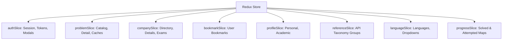
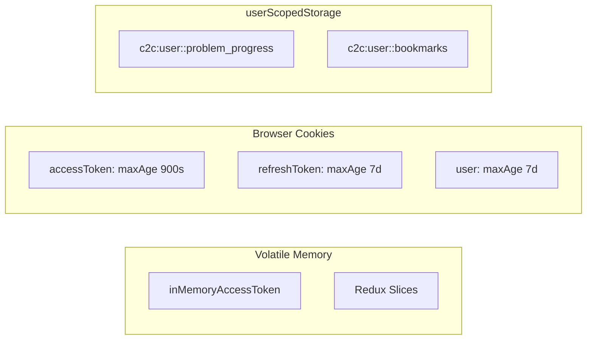

# 06. State Management & Data Flow Architecture

## 1. Redux Toolkit Architecture

State management is centralized with **Redux Toolkit** in [`src/app/store.ts`](../../src/app/store.ts).



### Typed Hooks
All components MUST use typed hooks from [`src/app/hooks.ts`](../../src/app/hooks.ts):
```ts
export const useAppDispatch = useDispatch.withTypes<AppDispatch>();
export const useAppSelector = useSelector.withTypes<RootState>();
export const useAppStore = useStore.withTypes<AppStore>();
```

---

## 2. Redux Slice Inventory

### 1. `authSlice` ([`src/features/auth/redux/authSlice.ts`](../../src/features/auth/redux/authSlice.ts))
- **Responsibilities**: User profile object, JWT access token, session authentication status (`LOADING`, `AUTHENTICATED`, `UNAUTHENTICATED`), global auth modal state (`login`, `signup`, `forgot`).
- **Key Thunks**:
  - `loginUser`: Authenticates credentials with `POST /auth/login`, syncs `tokenStorage`.
  - `refreshSessionThunk`: Proactively refreshes token with single-flight locking.
  - `logoutUser`: Clears server session and unsets all cookies/storage.
- **Bootstrap behavior**: If the access token is expired but refresh-session evidence exists, `initializeAuth` leaves the state at `LOADING` for `AppRouterLayout`'s refresh attempt instead of deleting the refresh session before it runs.
- **Refresh response shape**: `/auth/refresh` may return only token/role/ID fields. The service and reducer merge this response with the current profile so email/name are not erased. Refresh-token storage is owned by `tokenStorage`, not duplicated in Redux.
- **Reducer purity**: Cookie reads occur in the `initializeAuth` action prepare callback and token writes occur in `authService`; reducers only apply action payloads.

### 2. `problemSlice` ([`src/features/problems/redux/problemSlice.ts`](../../src/features/problems/redux/problemSlice.ts))
- **Responsibilities**: Problem list, active filters, selected problem details, independent loading states (`listLoading`, `detailLoading`), request IDs for race-condition cancellation.
- **Caching Mechanics**:
  - `listCache`: TTL 60 seconds, max 30 entries. Keys computed from sanitized filter JSON (`getProblemListKey`).
  - `detailCache`: TTL 5 minutes, max 40 entries. Keys based on normalized problem slug or ID.
  - LRU Trimming: `trimCache` evicts oldest cache entries when capacity is reached.

### 3. `companySlice` ([`src/features/companies/redux/companySlice.ts`](../../src/features/companies/redux/companySlice.ts))
- **Responsibilities**: Recruiter directory list, selected company metadata, company-associated problems, exams list, and active exam blueprints.
- **Loading invariant**: The aggregate `loading` flag includes company-problem requests and is recomputed when each independent request settles.

### 4. `progressSlice` ([`src/features/progress/redux/progressSlice.ts`](../../src/features/progress/redux/progressSlice.ts))
- **Responsibilities**: Maps of solved/attempted problems plus the raw API records used by profile metrics. This prevents the profile route from repeating the two progress requests already made at application hydration.
- **Hybrid Storage Model**:
  - Backed by `userScopedStorage` with key `problem_progress`.
  - Automatically migrates legacy keys (`solved_problems`, `dsa_sheet_solved`).
  - On app startup or user login, `hydrateProgress` queries the backend:
    - `GET /{userId}/getSubmiteedQuestionIds`
    - `GET /{userId}/getAPttemptedQuestionIds`
    - Merges remote cloud states with local scoped storage.
- **Request ownership**: `currentRequestId` plus `loadingUserId` allow a newly authenticated user to supersede an in-flight request for the previous user; late fulfilled/rejected actions are ignored.
- **Failure handling**: A new user scope clears the previous account's data as soon as hydration starts. One successful endpoint is retained with a warning; if both endpoints fail, the reducer uses that user's scoped local progress and exposes a warning instead of leaking the prior account or presenting an unexplained blank state.

### 5. `bookmarkSlice` ([`src/features/bookmarks/redux/bookmarkSlice.ts`](../../src/features/bookmarks/redux/bookmarkSlice.ts))
- **Responsibilities**: User's bookmarked problems.
- **Thunks**: `fetchBookmarks`, `toggleBookmark` (calls `POST` or `DELETE /users/{userId}/questions/{questionId}/bookmark`).
- **Identity**: A bookmark is keyed by both `type` and `itemId`; for example, `PROBLEM:1` and `APTITUDE:1` are distinct.
- **Mutation concurrency**: `pendingToggleKeys` deduplicates only an identical in-flight mutation. Fulfilled mutations update the current array item-by-item instead of replacing it with a stale thunk snapshot, so concurrent toggles for different items cannot overwrite each other.
- **Server boundary**: Authenticated problem bookmarks use the API. COMPANY/APTITUDE bookmarks remain an explicitly scoped browser-only fallback because no matching backend contract was found.
- **Failure handling**: A failed server refresh remains rejected, preserves the active user's last known problem bookmarks, restores only scoped COMPANY/APTITUDE items, and exposes the error. Browser persistence filters out server-owned problem bookmarks.

### 6. `profileSlice` ([`src/features/profile/redux/profileSlice.ts`](../../src/features/profile/redux/profileSlice.ts))
- **Responsibilities**: Session-derived immutable identity and `/userInfo/{userId}` academic/personal fields. Activity metrics belong to `progressSlice`.
- **Persistence boundary**: Academic records are server-derived and held only in Redux/component memory for the active session. `ProfileSettings` no longer caches them in `localStorage`.
- **Single source of truth**: `ProfileSettings` renders academic data directly from the slice rather than maintaining a second component copy.
- **Request ownership**: Fetch and save actions carry a request ID and user ID. A late fetch for an old user, or a fetch superseded by a save, cannot overwrite current academic data.
- **Empty response caching and account switches**: A valid API `null` is cached for that user to prevent duplicate requests. Auth transitions clear the previous user's record immediately, and an omitted response `userId` is filled from the requested route identity before reducer ownership checks.

### 7. `referenceSlice` ([`src/features/references/redux/referenceSlice.ts`](../../src/features/references/redux/referenceSlice.ts))
- **Responsibilities**: Shared API taxonomy for `DIFF`, `TOPIC`, `QPF`, `SUBJECT`, dynamic subject groups, `GENDER`, `LANG`, and `TESTCASETYPE`.
- **Cache semantics**: Group codes are normalized, identical in-flight requests are deduplicated, successful results (including empty arrays) have a 30-minute TTL, and explicit retry uses `force`. Each group tracks its owning request ID so an older response cannot replace a newer refresh.
- **Component boundary**: Components use `useReferenceGroup`; direct reference-service calls outside the slice are prohibited.

### 8. `languageSlice` ([`src/features/languages/redux/languageSlice.ts`](../../src/features/languages/redux/languageSlice.ts))
- **Responsibilities**: Compilers, Judge0 language IDs, versions, and dropdown options.
- **Service cache coordination**: Redux applies a 30-minute TTL and stale-response ownership. The execution service deduplicates its transport request with the same TTL; forced refresh bypasses it. Successful admin mutations invalidate both caches before the next editor/run lookup. Execution refuses an ID absent from API catalog fields instead of applying a static mapping.

### Persistence Middleware

[`src/app/clientPersistenceMiddleware.ts`](../../src/app/clientPersistenceMiddleware.ts) writes the resulting bookmark/progress state after relevant actions finish. This removes browser-storage writes from reducers and prevents an older thunk snapshot from persisting over newer Redux state. Storage failure is non-fatal; active-session Redux state remains usable.

---

## 3. Storage Hierarchy & Scoping Model



Credentials and user-profile metadata are intentionally excluded from `localStorage` and `sessionStorage`. `tokenStorage` uses in-memory values plus the existing cookie contract; legacy web-storage copies are deleted during session writes and logout. Server-owned academic records, admin question metadata, test cases, and submission history are held in memory and refreshed from their APIs, never mirrored to browser storage. The retained scoped storage is limited to manual/offline progress and COMPANY/APTITUDE bookmark fallbacks, for which the observed API contracts do not provide equivalent full persistence; theme, notification, language, and post-login redirect are non-sensitive UI preferences/state.

### `userScopedStorage` Architecture
Browser storage is shared across users on the same machine. To eliminate privacy leaks when a user logs out and another logs in:
1. When unauthenticated, scope is string `"guest"`.
2. When authenticated, scope key is `id:<userId>` or `email:<email>`.
3. Identity is hashed using an FNV-1a 32-bit algorithm:
   ```ts
   function hashScope(value: string): string {
     let hash = 2166136261;
     for (let i = 0; i < value.length; i += 1) {
       hash ^= value.charCodeAt(i);
       hash = Math.imul(hash, 16777619);
     }
     return (hash >>> 0).toString(36);
   }
   ```
4. All local keys become `c2c:user:<hash>:<key>`. Each user's browser data is completely isolated.
