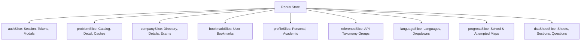
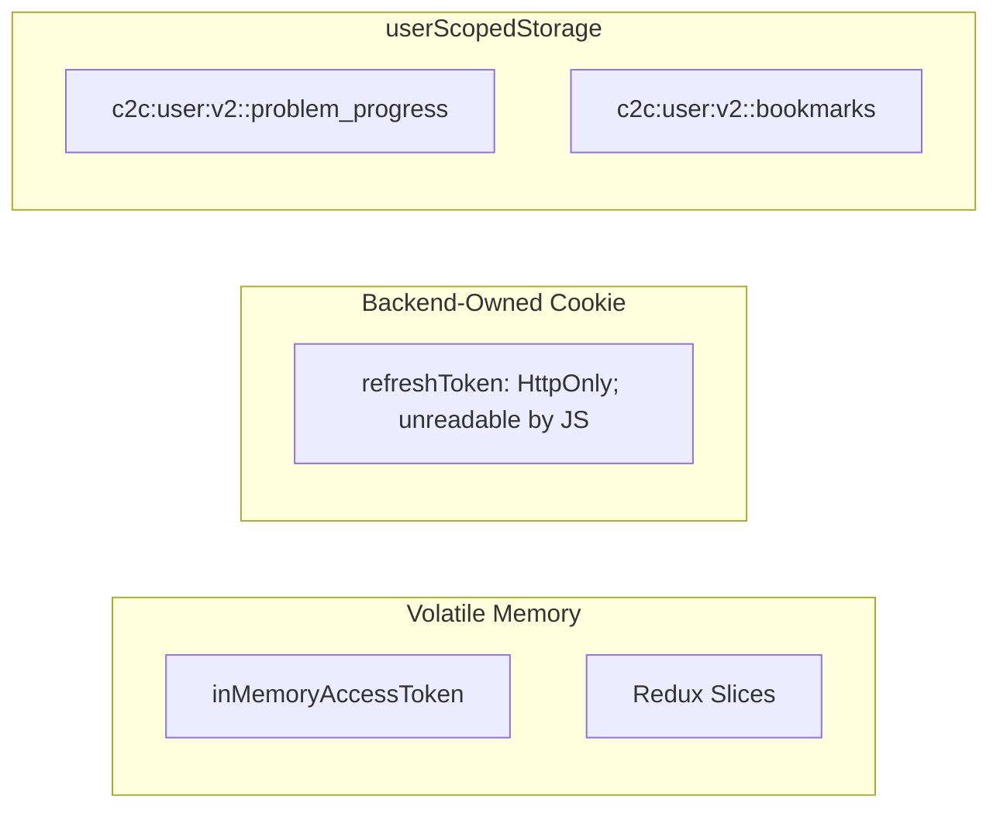

# 06. State Management & Data Flow Architecture

## 1. Redux Toolkit Architecture

State management is centralized with **Redux Toolkit** in [`src/app/store.ts`](../../src/app/store.ts).



### Typed Hooks
All components MUST use typed hooks from [`src/app/hooks.ts`](../../src/app/hooks.ts):
```ts
export const useAppDispatch = useDispatch.withTypes<AppDispatch>();
export const useAppSelector = useSelector.withTypes<RootState>();
export const useAppStore = useStore.withTypes<AppStore>();
```

---

## 2. Redux Slice Inventory

### 1. `authSlice` ([`src/features/auth/redux/authSlice.ts`](../../src/features/auth/redux/authSlice.ts))
- **Responsibilities**: User profile object, JWT access token, session authentication status (`LOADING`, `AUTHENTICATED`, `RECOVERY_REQUIRED`, `UNAUTHENTICATED`), global auth modal state (`login`, `signup`, `forgot`).
- **Key Thunks**:
  - `loginUser`: Authenticates credentials with `POST /auth/login`, syncs `tokenStorage`.
  - `refreshSessionThunk`: Restores startup/OAuth sessions through the shared cross-tab refresh coordinator; protected-request refresh remains HTTP-401-driven.
  - `logoutUser`: Clears access/profile memory and every protected Redux cache on `pending`, redirects to login, and reports the real bodyless backend logout result.
- **Bootstrap behavior**: If the access token is expired but refresh-session evidence exists, `initializeAuth` leaves the state at `LOADING` for `AppRouterLayout`'s refresh attempt instead of deleting the refresh session before it runs.
- **Refresh ownership**: `/auth/refresh` is bodyless; the browser sends the backend-owned HttpOnly cookie. Startup, OAuth completion, and 401 retry all call the same same-tab/Web-Locks coordinator. A browser without Web Locks enters the recoverable failure path without sending an uncoordinated refresh. Validated token/profile fields update memory and Redux; no refresh-token API exists in `tokenStorage`.
- **Authorization presentation**: Admin routing/navigation uses only the role supplied by login/refresh response data. JWT payload claims are not decoded for authorization decisions.
- **Session response boundary**: Login and refresh establish authentication only after validating the access token (`token` or backend compatibility alias `accessToken`), `id`, `role`, and `email`. The boundary normalizes the result to canonical `token` before Redux or storage receives it.
- **Startup recovery state**: `RECOVERY_REQUIRED` distinguishes network/5xx/contract failures from refresh HTTP 401. Route guards render a retry gate without exposing protected content; only HTTP 401 becomes `UNAUTHENTICATED`.
- **Feature mount boundary**: `AuthenticatedFeatureGate` keeps Problems, Problem Details, DSA Sheet, Company Prep, and Aptitude page trees unmounted until the session is authenticated. Their catalog/reference/detail effects therefore cannot issue API calls for signed-out visitors. The bodyless cookie-backed `/auth/refresh` still runs because it is the only contract-safe way to discover an existing HttpOnly-cookie session.
- **Reducer purity**: Cookie reads occur in the `initializeAuth` action prepare callback and token writes occur in `authService`; reducers only apply action payloads.

### 2. `problemSlice` ([`src/features/problems/redux/problemSlice.ts`](../../src/features/problems/redux/problemSlice.ts))
- **Responsibilities**: Problem list, active filters, selected problem details, independent loading states (`listLoading`, `detailLoading`), request IDs for race-condition cancellation.
- **Caching Mechanics**:
  - `listCache`: TTL 60 seconds, max 30 entries. Keys computed from sanitized filter JSON (`getProblemListKey`).
  - `detailCache`: TTL 5 minutes, max 40 entries. Keys based on normalized problem slug or ID.
  - LRU Trimming: `trimCache` evicts oldest cache entries when capacity is reached.
- **Visible-query invariant**: When a page/filter request changes the list cache key, the reducer immediately swaps to a fresh matching cache entry or clears the visible rows and initializes pagination for the requested page. It never presents rows from the previous query under new controls. Same-query refreshes may retain their current rows while the refresh status is shown.
- **Server-owned list controls**: Practice sends URL-backed difficulty, topic, company, search, page, and page-size values through `fetchProblems` to `POST /questions`; it does not load a large catalog and slice it in the browser. Platform remains response metadata only because the captured list request does not establish a platform-filter field. Company directories request the selected `/company/list` page directly. Company-detail coding and MCQ tabs debounce search, resolve difficulty/subject IDs from reference groups, and request each page from `/questions` or `/mcq`. Controls without an observed backend field are not rendered as catalog filters.
- **Request ownership**: Only the exact owning list/detail request may write a cache entry, replace visible rows, or release its loading state. A response arriving after logout, account switch, reset, or supersession is ignored before any protected cache write.

### 3. `companySlice` ([`src/features/companies/redux/companySlice.ts`](../../src/features/companies/redux/companySlice.ts))
- **Responsibilities**: Recruiter directory list, selected company metadata, list/detail request ownership, and bounded list/detail caches. Company-associated questions and exams are loaded by their owning page services rather than duplicated in this slice.
- **Loading invariant**: The aggregate `loading` flag is recomputed from the independent company-list and company-detail requests.

### 4. `progressSlice` ([`src/features/progress/redux/progressSlice.ts`](../../src/features/progress/redux/progressSlice.ts))
- **Responsibilities**: Maps of solved/attempted problems plus the raw API records used by profile metrics. This prevents the profile route from repeating the two progress requests already made at application hydration.
- **Hybrid Storage Model**:
  - Backed by `userScopedStorage` with key `problem_progress`.
  - Automatically migrates legacy keys (`solved_problems`, `dsa_sheet_solved`).
  - On app startup or user login, `hydrateProgress` queries the backend:
    - `GET /{userId}/getSubmiteedQuestionIds`
    - `GET /{userId}/getAPttemptedQuestionIds`
    - Treats each successful remote resource as authoritative, including an empty result.
    - Uses the matching local scoped resource only when that remote request fails.
- **Request ownership**: `currentRequestId` plus `loadingUserId` allow a newly authenticated user to supersede an in-flight request for the previous user; late fulfilled/rejected actions are ignored.
- **Failure handling**: A new user scope clears the previous account's data as soon as hydration starts. One successful endpoint is retained with a warning; if both endpoints fail, the reducer uses that user's scoped local progress and exposes a warning instead of leaking the prior account or presenting an unexplained blank state.

### 5. `bookmarkSlice` ([`src/features/bookmarks/redux/bookmarkSlice.ts`](../../src/features/bookmarks/redux/bookmarkSlice.ts))
- **Responsibilities**: User's bookmarked problems.
- **Thunks**: `fetchBookmarks`, `toggleBookmark` (calls `POST` or `DELETE /users/{userId}/questions/{questionId}/bookmark`).
- **Identity**: A bookmark is keyed by both `type` and `itemId`; for example, `PROBLEM:1` and `APTITUDE:1` are distinct.
- **Mutation concurrency**: `pendingToggleKeys` deduplicates only an identical in-flight mutation. Fulfilled mutations update the current array item-by-item instead of replacing it with a stale thunk snapshot, so concurrent toggles for different items cannot overwrite each other.
- **Server boundary**: Authenticated problem bookmarks use the API. COMPANY/APTITUDE bookmarks remain an explicitly scoped browser-only fallback because no matching backend contract was found.
- **Failure handling**: A failed server refresh remains rejected, preserves the active user's last known problem bookmarks, restores only scoped COMPANY/APTITUDE items, and exposes the error. Browser persistence filters out server-owned problem bookmarks.
- **Timestamp boundary**: Server bookmark DTOs expose no original save timestamp, so hydrated problem bookmarks omit `savedAt`. Only records created locally receive a client creation timestamp.
- **Auth transitions**: A same-user refresh preserves the current bookmark state and freshness timestamp. An identity-changing login, refresh, or authenticated-session replacement clears protected state before the new account can render it.

### 6. `profileSlice` ([`src/features/profile/redux/profileSlice.ts`](../../src/features/profile/redux/profileSlice.ts))
- **Responsibilities**: Session-derived immutable identity and `/userInfo/{userId}` details (`regNumber`, `joinedYear`, `passedOutYear`, `college`, `bio`). Activity metrics belong to `progressSlice`.
- **Persistence boundary**: Academic records are server-derived and held only in Redux/component memory for the active session. `ProfileSettings` no longer caches them in `localStorage`.
- **API-field boundary**: `ProfileSettings` exposes only fields represented by the authenticated identity or `/userInfo/{userId}` contracts. Academic and editable personal values never fall back to legacy fields on the identity object. The unsupported email-notification and interface-language controls were removed rather than persisted locally. Global theme behavior remains owned by `ThemeProvider`, which uses the authenticated `/{userId}/getTheme` and `/{userId}/theme/{isDarkTheme}` contract.
- **Single source of truth**: `ProfileSettings` renders academic data directly from the slice rather than maintaining a second component copy.
- **Nullable identity cache**: `profileFetched` distinguishes an API-confirmed `null` identity result from the not-yet-requested state, preventing route remounts from repeating the same read and allowing the page to leave its initial skeleton.
- **Refresh continuity**: A validated refresh carries identity and role. Reapplying the same user preserves `/userInfo` caches; an explicit different user clears them. Session identity remains read-only because no profile-identity mutation contract is available.
- **Request ownership**: Fetch and save actions carry a request ID and user ID. A late fetch for an old user, or a fetch superseded by a save, cannot overwrite current academic data.
- **Empty response caching and account switches**: A valid API `null` is cached for that user to prevent duplicate requests. Auth transitions clear the previous user's record immediately, and an omitted response `userId` is filled from the requested route identity before reducer ownership checks.

### 7. `referenceSlice` ([`src/features/references/redux/referenceSlice.ts`](../../src/features/references/redux/referenceSlice.ts))
- **Responsibilities**: Shared API taxonomy for `DIFF`, `TOPIC`, `QPF`, `SUBJECT`, dynamic subject groups, `GENDER`, `LANG`, and `TESTCASETYPE`.
- **Cache semantics**: Group codes are normalized, identical in-flight requests are deduplicated, successful results (including empty arrays) have a 30-minute TTL, and explicit retry uses `force`. Each group tracks its owning request ID so an older response cannot replace a newer refresh.
- **Component boundary**: Components obtain group records through `useReferenceGroup`; the admin group-code catalog uses the validated `referenceService.getGroupCodes` read because it is a distinct endpoint and is not per-group state.
- **API-owned values**: Consumers never create static reference records or substitute legacy numeric IDs when a group is unavailable. This includes difficulty/platform metadata and admin exam classification from `EXAM SECTION TYPE` and `QUESTION TYPE`. Missing records remain unavailable and errors are surfaced for retry.
- **MCQ list coordination**: Unfiltered aptitude and admin MCQ list requests use stable empty ID arrays. Reference-group hydration therefore does not recreate the list callback, abort the first `/mcq` request, and issue an identical second request.

### 8. `languageSlice` ([`src/features/languages/redux/languageSlice.ts`](../../src/features/languages/redux/languageSlice.ts))
- **Responsibilities**: Compilers, Judge0 language IDs, versions, and dropdown options.
- **Service cache coordination**: Redux applies a 30-minute TTL and stale-response ownership. The execution service deduplicates its transport request with the same TTL; forced refresh bypasses it. Successful admin mutations invalidate both caches before the next editor/run lookup. Execution refuses an ID absent from API catalog fields instead of applying a static mapping.

### 9. `dsaSheetSlice` ([`src/features/dsaSheet/redux/dsaSheetSlice.ts`](../../src/features/dsaSheet/redux/dsaSheetSlice.ts))
- **Responsibilities**: Learning-sheet catalog, selected sheet ID, sections returned for each sheet, question links by section ID, nested UI expansion derived only from returned `parentSectionId` values, and per-resource loading/error ownership.
- **Caching Mechanics**:
  - `DSA_SHEET_CACHE_TTL_MS`: 5 minutes.
  - Granular timestamps: `sheetsFetchedAt`, `sectionsFetchedAt[sheetId]`, and `questionsFetchedAt[sectionId]`.
  - Seamless navigation: Switching between previously loaded sheets or accordion sections re-renders from memory instantly without layout shift or skeleton flashing.
  - Invalidation & Error Reset: `invalidateDsaSheetCache` and `resetDsaSheetErrors` provide programmatic cache flushes and retry resets.
- **Superseded Request Cancellation**:
  - In `DsaSheetPage`, section-question reads are abortable and request-owned. Nested visual rows are derived only from the documented sections response; no subsection transport request is made.
  - Successful admin sheet, section, association edit/delete operations dispatch `invalidateDsaSheetCache`, preventing an admin from seeing the previous five-minute cached student view after navigation.

### Persistence Middleware

[`src/app/clientPersistenceMiddleware.ts`](../../src/app/clientPersistenceMiddleware.ts) writes the resulting bookmark/progress state after relevant actions finish. This removes browser-storage writes from reducers and prevents an older thunk snapshot from persisting over newer Redux state. Storage failure is non-fatal; active-session Redux state remains usable.

---

## 3. Storage Hierarchy & Scoping Model



Access credentials and session profile metadata are held only in per-tab memory/Redux. `tokenStorage` never reads or writes the HttpOnly refresh cookie; it only removes obsolete JavaScript-readable access/profile aliases left by older builds. Server-owned academic records, admin question metadata, test cases, submission history, and an authenticated user's theme preference are held in memory and refreshed from their APIs, never mirrored to browser storage as authoritative state. The retained user-scoped storage is limited to manual/offline progress, COMPANY/APTITUDE bookmark fallbacks, and a non-sensitive theme fallback for the active identity or guest. `ProtectedRoute` stores `post_auth_redirect` separately in `sessionStorage` for the current tab.

On logout, the application removes the departing user's complete scoped cache—including progress, local bookmarks, and code drafts—before clearing memory. Only the non-sensitive `theme_pref` preference is retained. Other users' encoded scopes are never read or modified.

### `userScopedStorage` Architecture
Browser storage is shared across users on the same machine. To eliminate privacy leaks when a user logs out and another logs in:
1. When unauthenticated, scope is string `"guest"`.
2. When authenticated, scope key is `id:<userId>` or `email:<email>`.
3. The complete canonical identity is encoded with `encodeURIComponent` and versioned as `v2:<encoded-identity>`. This is injective for the input string and avoids cross-account collisions caused by the previous truncated 32-bit hash.
4. All local keys become `c2c:user:v2:<encoded-identity>:<key>`. Each user's browser data is isolated without relying on a probabilistic hash.
